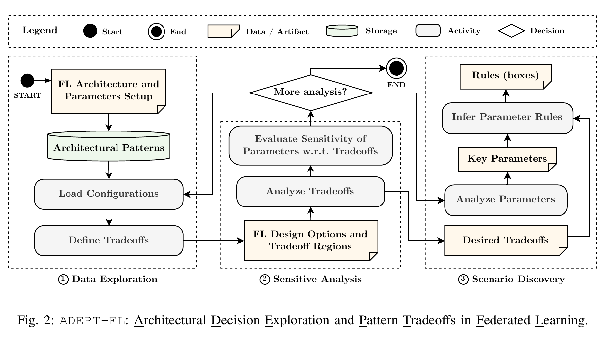
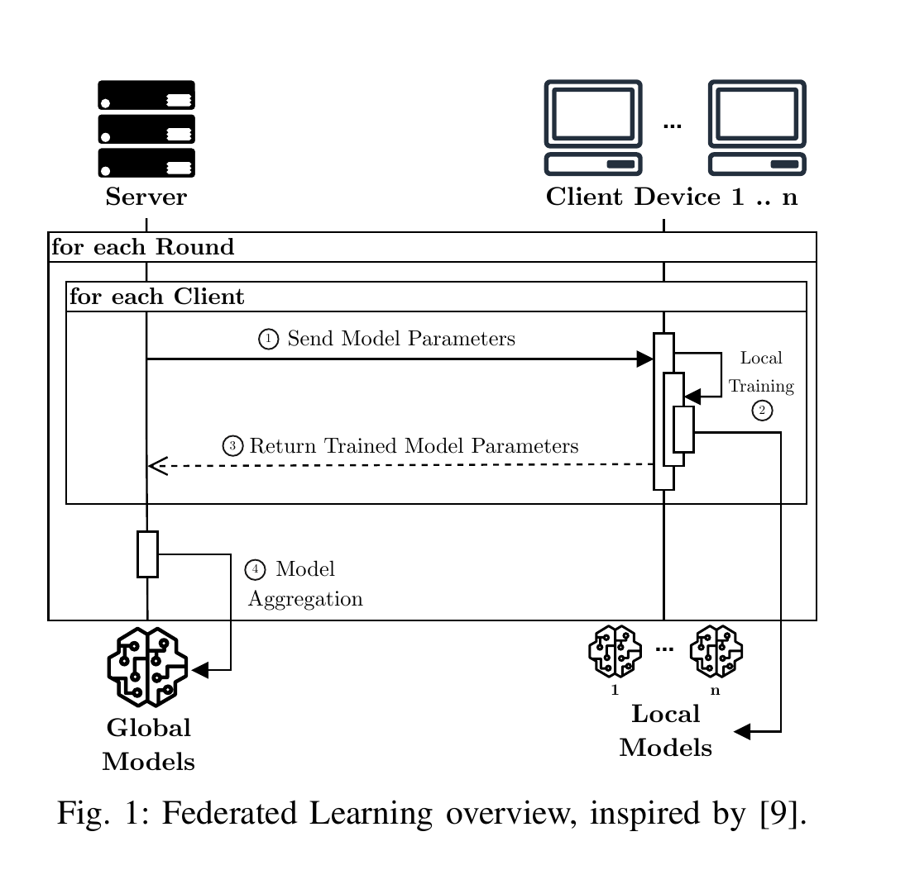

# ADEPT-FL


**Architectural Decision Exploration and Pattern Tradeoffs in Federated Learning**

ADEPT-FL applies ADEPT’s design-space analysis to federated-learning (FL) systems. It combines run data and an FL system definition with pattern-aware preprocessing, tradeoff analysis, sensitivity analysis, and parameter-rule inference.

The analyzed patterns are Client Selector, Heterogeneous Data Handler (HDH), and Message Compressor. The main outcomes are model accuracy (maximize) and average total round time (minimize). Pattern decisions, stress levels, federation size, client heterogeneity, and delay describe the design space.

## Analysis workflow



The workflow has three phases: **Data Exploration** configures the system, loads run data, and defines tradeoff regions; **Sensitivity Analysis** examines how design choices map to the target regions; **Scenario Discovery** infers parameter rules (boxes) for selected outcomes. The paper’s prose also describes the third phase as constraint inference. The paper labels the middle phase “Sensitive Analysis” in the diagram and “Sensitivity Analysis” in the text.

## Federated-learning round



Figure 1 shows the underlying FL execution cycle: the server broadcasts global model parameters, clients train locally, clients return updated parameters, and the server aggregates them for the next round. Figure 2 above shows how ADEPT-FL analyzes the resulting run data.

## Reproduce the paper analyses

Precomputed AP4Fed run data is included, so reproducing the analyses does not require running FL training again. The two CSV inputs and the system definition are in `federatedlearning/compact/`.

Set up the Python environment from this directory:

```bash
python3 -m venv .venv
source .venv/bin/activate
python -m pip install --upgrade pip
python -m pip install -r requirements.txt
```

Run a research question at a time, or run all four:

```bash
./federatedlearning/compact/run_paper_analyses.sh RQ1
./federatedlearning/compact/run_paper_analyses.sh RQ2
./federatedlearning/compact/run_paper_analyses.sh RQ3
./federatedlearning/compact/run_paper_analyses.sh RQ4
./federatedlearning/compact/run_paper_analyses.sh all
```

The runner executes the image and text notebooks for the selected question. To run one notebook manually, activate the environment, launch Jupyter from this directory, and open the notebook listed below:

```bash
jupyter lab
```

| Question | What it analyzes | Notebooks (for both `image` and `text`) |
|---|---|---|
| RQ1 | Each pattern enabled in isolation, across its stress levels | `analysis-fl-rq-stress-only-client_selector-*`, `analysis-fl-rq-stress-only-hdh-*`, `analysis-fl-rq-stress-only-message_compressor-*` |
| RQ2 | Supported two- and three-pattern combinations at 25%, 50%, and 75% stress | `analysis-fl-rq-combined-patterns-stress-{25,50,75}-*` |
| RQ3 | All pattern configurations at the smallest and largest federation sizes in the paper (4 and 10 clients) | `analysis-fl-rq-c4-*`, `analysis-fl-rq-c10-*` |
| RQ4 | Full-design constraint inference for the target tradeoff | `analysis-fl-rq-full-design-*` |

The `analysis-fl-rq-baseline-*` and `analysis-fl-rq-c8-*` notebooks are supporting analyses for the included data snapshot; they are not needed for the paper’s four RQs. Run them separately with `./federatedlearning/compact/run_paper_analyses.sh supporting`.

Notebook execution writes plots and box reports under the matching `image/` or `text/` directory. The two precomputed CSVs are `adept_experiments_all_waves.csv` and `adept_experiments_all_waves_combinedAP.csv`; `FLsystem_compact_all.json` declares their schema, aggregations, parameters, and outcome measures.

## AP4Fed data generation

The bundled CSVs are precomputed AP4Fed runs and are the inputs used for the paper analyses. To generate a new campaign, use [AP4Fed](https://github.com/IvanComp/AP4Fed), a Flower-based FL platform with local and Docker execution modes. Its [headless campaign instructions](https://github.com/IvanComp/AP4Fed#headless-experiments--cluster-runs) and setup details are maintained with the platform.

From a separate checkout of AP4Fed, the current campaign runner can be inspected and run as follows:

```bash
git clone https://github.com/IvanComp/AP4Fed.git
cd AP4Fed
python3 -m venv .venv
source .venv/bin/activate
python -m pip install -r requirements.txt
python run_adept_campaign.py --dry-run
```

For interactive setup instead of the headless runner, launch the AP4Fed interface with `python home.py` after installing its requirements. AP4Fed supports local execution; its Docker mode is intended for isolated clients and requires Docker plus Python 3.12 or newer.

The runner resumes the Local campaign before starting the Docker campaign. To populate the currently empty Local cells once, run `python run_adept_campaign.py --through-wave 1`; to resume and continue through the full Local and Docker matrices, run `python run_adept_campaign.py`. The runner records mode-specific indexes under `adept_campaign_results/local/` and `adept_campaign_results/docker/` and maintains a combined run index. Docker execution requires Docker and Python 3.12 or newer on the documented Linux host.

New campaign output is not substituted into the included precomputed inputs automatically. Confirm its settings and schema before using it in the notebooks.
