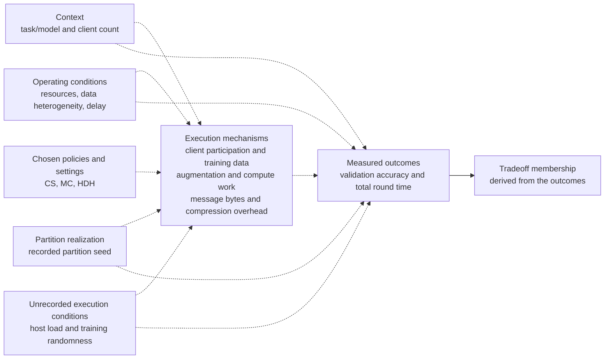

# ADEPT: a simple observational model of architectural tradeoffs

**Working revision: 2026-10-11.** This document supplies the concepts, minimal mathematics, and a hypothetical influence model for the paper. The intended reader is a software designer comparing architectural alternatives and their behavior under varying operating conditions.

The previous extended tables, encoding discussion, proofs, and implementation TODOs are preserved in [technical working notes](paper_adept_formal_extension_technical_notes.md). They support implementation work; the account below is the proposed paper formalization.

## 1. Decisions, policies, configurations, and runs

A **decision** is a design question, such as whether to use a client selector. A **policy** is one alternative for that decision, such as ON or OFF. A **configuration** selects one policy for every decision. It is a combination of choices, not another independently chosen variable.

For decisions with policy sets \(\mathcal P_1,\ldots,\mathcal P_J\), write

\[
c=(p_1,\ldots,p_J),\qquad p_j\in\mathcal P_j,\qquad
c\in\mathcal C\subseteq\mathcal P_1\times\cdots\times\mathcal P_J.
\]

The subset \(\mathcal C\) contains feasible policy combinations. Some systems prohibit combinations; the compact FL system permits all eight ON/OFF combinations. We do not need a separate projection function: \(c_j\) simply denotes the policy selected for decision \(j\).

| Concept | Meaning for the designer | FL example |
|:---|:---|:---|
| Decision and policy | A question and one of its alternatives | Message compression: ON or OFF |
| Configuration \(c\) | One policy for each decision | CS ON, MC OFF, HDH ON |
| Other levers \(l\) | Settings the designer can select in addition to those policies | Compression algorithm, selector threshold, local training settings |
| Context \(s\) | The application/deployment being compared or held fixed | Task/model and number of clients |
| Uncertainties \(u\) | Operating conditions that the designer does not directly select for the analysis | Resource limitations, data heterogeneity, network delay |
| Outcomes \(y\) | Measured qualities used to judge a design | Final validation accuracy and average total round time |
| Execution measurements \(m\) | Recorded or derived descriptions of what happened during a run | Participating clients, actual HDH work, inferred instance counts |
| Run identifier and seed \(z\) | Information identifying executions and recorded sources of variation | `run_id`; `partition_seed` used for matching |

These roles depend on the design question. Client count can be a lever when sizing a deployment and context when comparing policies at a fixed size. Resource provisioning can likewise be a lever in a different study. An uncertainty can be deliberately varied by the experimenter while remaining outside the application's control. Being varied in an experiment does not determine its architectural role.

**Pattern settings belong to the choices.** If an ON policy fixes a threshold, that threshold is a binding of the policy, not an independent uncertainty. If several thresholds are selectable, they are additional lever values or distinct policies. An OFF pattern has inapplicable settings, written \(\bot\), meaning “not selected.” This is different from an unknown value or an unlogged measurement. A fully specified design includes both \(c\) and any additional selectable settings \(l\).

**A configuration is not a run.** The same configuration can have several runs under different conditions or seeds and can produce different outcomes. One observed row is

\[
r=(c_r,l_r,s_r,u_r,z_r,m_r,y_r).
\]

The feasible space specifies what could be evaluated. The observed dataset specifies what was actually evaluated. Missing configuration–condition combinations have no empirical result; their behavior is not filled in by the notation.

## 2. A concrete compact-FL example

Use the same policy order throughout:

\[
c=(p_{\mathrm{CS}},p_{\mathrm{MC}},p_{\mathrm{HDH}})
\in\{\mathrm{OFF},\mathrm{ON}\}^{3}.
\]

`000` is the all-OFF baseline, `100` is CS alone, and `101` combines CS and HDH. The shorthand digits encode policies; they are not numerical doses of a pattern.

For the executed analysis:

- \(s\) contains task/model and client count: AG_NEWS/MLP or CIFAR-10/CNN 16k, with 4, 8, or 10 clients.
- \(u\) contains the recorded percentages of low-spec, non-IID, and delayed clients. These summaries do not completely describe a realized data partition or runtime environment.
- \(y\) contains accuracy, which is maximized, and total round time, which is minimized.
- The recorded partition seed is used as a matching key. Unlogged training randomness, host load, and scheduling may still vary.

The compact campaign has 2,340 runs in 234 observed configuration–condition cells, each with seeds 1–10 represented once. All eight configurations are present, but the environmental points are not fully crossed across them. The common environmental point is 25% low-spec, 25% non-IID, and 25% delayed clients. Comparisons across all configurations are supported there; other comparisons use the environmental points shared by the particular configurations.

Some recorded settings encode policy presence rather than setting optimization. For example, an HDH batch size fixed at 32 whenever HDH is ON can distinguish ON from OFF, but cannot establish that 32 is preferable to another batch size. The compact CS records use threshold 7 whereas the declarative ON binding says 2; the paper must distinguish the recorded execution from that unresolved metadata mismatch.

### 2.1 Observation level: compact summaries first

The current study deliberately starts with the **compact, run-level representation**. The detailed data retain client-level execution records over rounds; analyzing those records to explain individual-client behavior is deferred until the compact design space is better understood. The influence model identifies possible mechanisms without claiming that this detailed analysis has been performed.

There are distinct aggregation steps. The compact records summarize each execution, including per-client columns such as average CPU/RAM usage. ADEPT then averages the selected numeric client columns within each run to obtain features such as `CPU Mean`, `RAM Mean`, and `JSD Mean`. Categorical client fields are summarized by the number of distinct observed values, not by an arithmetic mean. Configuration-level outcome means shown in the findings are a further average across runs; they are not client averages.

For a numeric client field, the feature used in the compact analysis is simply

\[
\bar x_r=\frac{1}{|I_r^{\mathrm{obs}}|}
\sum_{i\in I_r^{\mathrm{obs}}}x_{ri}^{\mathrm{compact}},
\]

where \(I_r^{\mathrm{obs}}\) contains the clients with a recorded value for that field. If none has a value, the mean is missing. Consequently, a resource-allocation mean and a resource-usage mean need not describe the same set of clients: usage may be recorded only for participants. This is especially relevant when comparing CS ON and OFF. The aggregation rule and the population contributing to a mean belong to its interpretation.

**Equal averages do not imply equal client populations.** Hypothetically, CPU allocations `(2,2,2,2)` and `(1,1,3,3)` both average to 2, but have different resource imbalance. Means also hide which client combines low resources, heterogeneous data, and delay, as well as transient or slowest-client behavior. The recorded environment shares preserve some composition information, but not these joint relationships.

Therefore, a box on `CPU Mean` or `JSD Mean` constrains a **run-level summary**, not every client's value. Feature importance identifies associations with that summary, not an individual-client mechanism. RQ4 describes variability in aggregate run outcomes, not variability among clients or rounds. For the designer, the present results can shortlist configurations and operating envelopes at this resolution; they cannot establish per-client requirements or explain bottlenecks hidden by averaging.

The existing use of detailed logs to count actual HDH activity is a limited supporting measurement, distinct from the deferred general client-level analysis. The compact findings remain the primary evidence for the present phase.

## 3. Outcomes and tradeoff targets

ADEPT examines the **observed distribution of outcomes conditional on design and operating conditions**:

\[
Y\mid C=c,\ L=l,\ S=s,\ U=u.
\]

Uppercase symbols denote dataset variables; lowercase symbols denote their values. This conditional distribution does not assert that changing a policy causes the observed difference. It also does not specify a probability distribution over future operating environments.

A **tradeoff target** is an explicit region \(T\) of the outcome space. A run meets the target when \(y_r\in T\). For example,

\[
T=\{y:\ \text{accuracy}\ge0.90\ \land\ \text{round time}\le11\text{ s}\}.
\]

This numerical target is illustrative. The notebooks also use discretized regions such as `L-M`: high accuracy and medium time. The target may represent an acceptable service requirement or one region of interest; not every discovered region is necessarily desirable. Bin boundaries must stay fixed across analyses intended to compare the same target. Recomputing bins in each slice changes the target.

The outcome distribution matters alongside target attainment. Two configurations with similar means can differ in their ranges, tails, or frequencies of missing a requirement. A designer needs both the tradeoff and its stability.

Missing outcomes require a stated treatment. A documented execution failure can count as failure to meet a successful target. A logging gap is an unobserved outcome and needs an explicit exclusion/reporting rule. An inapplicable pattern setting is neither of these. The formal definitions below assume that target membership is known for the included runs; unknown memberships are not silently counted as successes or failures.

## 4. Comparing policies within complete configurations

Grouping all runs with CS ON answers “what happened among the sampled designs using CS?” Such a group mixes other policies and operating conditions. It does not isolate the association with selecting CS.

For a one-decision comparison, select two configurations that differ only in decision \(j\). Fix the other policies and any other selectable settings that are not intrinsic to the compared policy. Let \(k\) identify a shared task, client count, environment point, and partition seed. Then

\[
\Delta_j(k)=\bar y(c^{\mathrm{ON}},k)-\bar y(c^{\mathrm{OFF}},k).
\]

The bars allow several runs per arm; the compact campaign has one per arm at each matched seed-setting. Report the equal-weight mean over available matched settings, the distribution of differences, sign frequencies, and the number of pairs. A positive accuracy difference favors ON; a negative time difference favors ON. If ON changes its own required pattern settings, the comparison describes that policy with its bindings, not a separate setting effect.

Repeating the comparison with different companion policies describes **composition dependence**. An MC comparison with CS OFF and HDH OFF is a different comparison from an MC comparison with CS ON and HDH OFF. Sign changes suggest that the observed tradeoff depends on composition; they do not alone establish a causal or statistically assessed interaction.

Partition-seed matching aligns the recorded seed, not every random influence or execution condition. Hosts and scheduling remain unmatched, and the same seed does not itself prove identical participating training data. Use “matched descriptive difference” in the paper.

For example, the executed standalone-CS comparison has 180 matched pairs, with mean accuracy difference −2.58 percentage points and mean time difference −3.59 seconds. This supports a sampled speed–accuracy tradeoff for that policy comparison. It does not establish an invariant CS effect across tasks, compositions, or deployments. Detailed evidence is in the [RQ synthesis](fl_research_question_synthesis.md).

## 5. Boxes and observational what-if robustness

A **box** \(B\) is a conjunction of conditions such as “CS ON,” “delay share at most a given value,” and “task = text.” Numeric conditions are intervals; categorical conditions select sets of values. Its meaning depends on the roles of the constrained variables:

Interpret that conjunction together with the system's policy bindings and applicability rules. A condition on an optional setting may imply a policy requirement, but a binding “policy ON fixes this value” is not automatically reversible: another policy may use the same value, or OFF applicability may be unspecified. Resolve all conditions jointly, retain compatible configuration alternatives, and distinguish specification consistency from observed support. Environmental conditions such as non-IID percentage do not require HDH ON merely because they are relevant to its intended mechanism. The [semantic box-explanation proposal](box_semantic_explanation_proposal.md) describes how ADEPT can trace each condition to its architectural meaning and aggregation provenance.

| Box conditions | Interpretation | Action available to the designer |
|:---|:---|:---|
| Choices only: configuration and other levers | Candidate prescription | Select the covered choices, then validate the candidate |
| Context or uncertainty conditions only | Operating envelope | Assess applicability; plan monitoring, admission criteria, or resource requirements where feasible |
| Choices plus context/uncertainties | Conditional prescription | Select the choices when the stated conditions hold |
| Realized execution measurements | Diagnostic condition | Identify what executions resemble the target; establish a controllable or observable proxy before using it prospectively |

A box can contain several of these kinds of condition. **Controllability and availability before execution must both be checked** before treating its rule as an actionable design restriction. A rule on realized HDH work cannot be applied before the run merely because HDH ON is selectable.

For a configuration \(c\), a fixed analysis context/slice, and a target \(T\), define the baseline and box-constrained success rates as

\[
R_0(c,T)=P(Y\in T\mid C=c),\qquad
R_B(c,T)=P(Y\in T\mid C=c,B),\qquad
G_B(c,T)=R_B(c,T)-R_0(c,T).
\]

Context and any fixed settings are suppressed here for readability. The probabilities describe the evaluated campaign population or sample. They average over its retained operating conditions and seeds; a different deployment distribution can yield different rates.

**The observational what-if question is:** “Among the evaluated runs of this configuration, how consistently was the target reached when the box's conditions held?” Applying the box means filtering the evaluated space. Higher conditional success is a candidate robustness improvement within that space; it is not the estimated result of forcing a system into those conditions.

On the held-out evaluation set, report four counts:

- \(n\): runs of configuration \(c\);
- \(n_T\): those runs meeting the target;
- \(n_B\): those runs satisfying the box;
- \(n_{BT}\): those satisfying the box and meeting the target.

These counts give the complete interpretation:

\[
\widehat R_0=\frac{n_T}{n},\qquad
\widehat R_B=\frac{n_{BT}}{n_B},\qquad
\text{retention}=\frac{n_B}{n},\qquad
\text{target coverage}=\frac{n_{BT}}{n_T}.
\]

Box density is \(\widehat R_B\); coverage is target recall; retention is how much of the evaluated space remains. Report gain in percentage points together with all counts. A box with 100% density over three runs has a different evidential weight and practical scope from one with 100% density over hundreds. If \(n_B=0\), constrained success and gain are undefined; if \(n_T=0\), target coverage is undefined. Do not convert these cases to zero-valued evidence.

A pooled box's density averages over configurations within the box. It need not equal the density for any particular configuration, so a pooled gain does not establish a gain for every covered design.

**Two meanings of stability must remain separate.** Higher target success means greater robustness of *tradeoff membership*. Lower dispersion of continuous accuracy/time means more stable *outcome values*. A box can improve target success without reducing variance, and it can reduce variance around an unacceptable outcome. Compare continuous distributions separately when claiming reduced outcome variability.

An executed example is the all-OFF configuration's `M-M` target: the evaluated success rate goes from 33/107 (30.8%) to 31/31 (100%) within the box. The gain is 69.2 percentage points, with 29.0% retention and 31/33 (93.9%) target coverage. This is a useful conditional alternative if the designer can accept and satisfy the box's restrictions; it does not imply improvement throughout the original space. See the [RQ2 findings and validation flags](fl_research_question_synthesis.md).

Implementation terminology needs care. ADEPT's policy robustness matrix contains box-constrained rates, not gains. Its uplift report's `Coverage` is retention, whereas discovery coverage is target recall. Discovery `lift` compares test density with training prevalence; it is not the same quantity as the within-configuration, same-test-set gain defined above. Some current decoded-box evaluations are flagged for boundary/support discrepancies and cannot support improvement claims until reconciled.

## 6. Hypothetical influence model

The following diagram is a **hypothetical influence model** for discussing possible mechanisms. Its arrows are assumptions, not relationships identified by the notebook analyses, and no causal effect is estimated from this graph. For a box explanation restricted to directed links declared in the JSON and ADEPT conceptual model, see the [specification-aware explanation proposal](box_semantic_explanation_proposal.md).

Dashed arrows denote hypothetical influences. Solid arrows into tradeoff membership denote its deterministic definition. The grouped nodes keep the diagram readable. They do not imply that every policy influences every mechanism, that each operating condition has every outgoing influence, or that every mechanism influences both outcomes. The table below separates the pattern pathways. The graph abstracts an entire run; it is not a temporal model of every FL round.

| Decision | Hypothesized mechanism | Possible tradeoff behavior to investigate | Evidence needed beyond an outcome association |
|:---|:---|:---|:---|
| CS | Changes which clients participate, affecting compute/communication work and the training-data composition | Time savings can accompany accuracy loss; direction can vary with composition and environment | Participation, client resources, represented training data, and timing components |
| MC | Changes transmitted bytes and adds compression/decompression work | Communication savings may or may not outweigh processing overhead | Bytes, communication time, compression/decompression time, and bandwidth/load |
| HDH | When applied, changes training data and adds augmentation work | Accuracy benefits are possible but not guaranteed; extra work can affect time | Actual augmentation counts, data characteristics before/after handling, and work duration |

For the compact campaign, MC uses `zlib`, a lossless compressor. This model therefore proposes a message-handling pathway to time and does not assume a direct accuracy loss from compression. An observed MC–accuracy association could reflect execution differences or the sampled conditions; it does not establish a lossy-compression mechanism. HDH ON likewise does not guarantee that augmentation happened: the logs show substantial task dependence in actual HDH work.

This influence model is useful for the designer because it suggests **which measurements would explain a tradeoff**, and which assumptions need checking when transferring a design to another environment. It does not justify statements such as “HDH caused this accuracy change.” The observational conclusion remains “these outcomes were associated with these choices and conditions in the evaluated runs.”

The diagram also omits how the campaign selected configurations, conditions, and hosts. Those assignments may be associated with one another. The absence of arrows among the input nodes does not assert that their observed values are statistically independent or randomized.

**Execution measurements have a different role from external inputs.** Realized participants, HDH work, and pattern-instance counts can depend on both choices and operating conditions. Matching on them can compare different subsets selected by the choices themselves. They may help diagnose mechanisms, but should not be treated as ordinary pre-execution uncertainties or added automatically to the policy-matching keys. JSD is also recorded only for HDH-ON runs in this campaign; its availability can encode policy presence, independently of its numerical information.

The number of enabled pattern types is derived from \(c\). It is not an independently adjustable lever: one enabled pattern could mean CS, MC, or HDH, with different behavior. Realized pattern-instance count is a derived execution descriptor, with measured and inferred components. Its association with outcomes can combine composition, client count, participation, and augmentation. A higher count does not by itself imply that “more patterns” caused a change.

## 7. How the model supports the research questions

| Research question | Observational quantity | Conclusion available to the designer |
|:---|:---|:---|
| RQ1: configuration tradeoffs | Outcome distributions and target rates for complete configurations on comparable support | Which sampled alternatives trade accuracy for time, and which merit a shortlist |
| RQ2: conditions and robustness | Held-out box density, within-configuration gain, retention, target coverage, and support | Which restrictions define a promising operating envelope or candidate prescription, and what scope is sacrificed |
| RQ3: individual patterns and composition | Matched one-decision differences, repeated with companion policies fixed | How a policy's observed tradeoff varies across tasks and compositions |
| RQ4: remaining variability | Outcome spread across runs in the same modeled configuration–condition cell | How reliably the alternative met a requirement in those runs, and which additional measurements may be needed |

RQ4's within-cell variability includes variation across partition seeds and unrecorded execution conditions. It does not measure irreducible noise with every input fixed. A random train/test split within this campaign evaluates interpolation over its rows, not validation on an entirely new deployment.

Feature importance supports variable screening and comparison of predictive trends. It supplies neither an effect direction nor a causal importance score. Correlated features can substitute for each other, and policy-specific measurement availability can make a diagnostic feature appear important. Use the [feature-importance audit](fl_feature_importance_audit.md) and matched contrasts to qualify interpretations. A variable absent from a box may have been screened out rather than shown to be irrelevant.

A simple analysis sequence is: define choices and variable roles; audit observed support; define stable targets; compare configurations and matched policies; learn boxes on training data; evaluate conditional robustness on held-out data; then add a specification-based explanation of each rule. The optional influence model is separate from this syntactic explanation. Encoding, correlation screening, and algorithms remain implementation details beneath this account. When used, correlation pruning precedes the final random-forest importance scores.

## 8. Review of the previous formalization

The earlier document contains useful implementation material, but several statements need qualification before reuse:

| Previous formulation | Revision and reason |
|:---|:---|
| Separate decision, policy, configuration, projection, and binding machinery throughout the main account | Use a policy tuple \(c\), additional settings \(l\), and explicit variable roles. Keep encoding/binding details in the technical notes. |
| A realized instance count is an uncertainty because the designer does not directly select it | Separate external conditions from derived execution measurements. A quantity can be uncontrolled and still depend on the decision under study. |
| A pattern-type count is a lever | Treat it as a configuration summary. Choosing the count alone does not identify which policies are selected. |
| A marginal group reaching density at least 0.99 requires each configuration in it to reach 0.99 | This holds for exact density 1 with positive weights, not for the 0.99 threshold. Equal-size configurations with densities 1.00 and 0.98 have pooled density 0.99. |
| All strictly increasing encodings preserve every discovered box | Avoid an unrestricted invariance claim. Quantile interpolation, boundary thresholds on unseen values, tie handling, and floating-point evaluation can matter. Fixed-encoding membership equivalence is the narrower requirement, and must hold in the implementation. |
| Any partially failed outcome vector is dominated by every successful vector after a worst-case substitution | This need not hold: a failed-accuracy run with substituted accuracy −0.1 and time 1 s is not dominated by a successful run with accuracy 0.9 and time 10 s. Exclude failed runs from a successful-design Pareto shortlist explicitly, or define feasibility precedence; one-coordinate substitution is insufficient. |
| Higher box density implies lower outcome variability | Report target-membership robustness and continuous-outcome dispersion separately. |
| The FL running example has 32 runs, four observed configurations, and five clients | Use the executed compact campaign: 2,340 runs, all eight configurations, two tasks, and 4/8/10 clients, with incomplete environmental crossing. |

The detailed TODOs remain in the preserved notes so simplification does not erase implementation concerns. The current document changes the conceptual account and proposed paper terminology; it does not change ADEPT's loader roles, notebook calculations, box implementation, or saved outputs.

## 9. Suggested paper-ready summary

> A design decision offers alternative policies. A configuration selects one policy for each decision and is evaluated with any additional design settings under a stated context and operating conditions. Executions produce quality outcomes and diagnostic measurements. ADEPT describes the observed relationship between these inputs and outcomes, compares configurations on shared support, and discovers conditions associated with target regions in the quality space. A discovered rule can describe a candidate design prescription, an operating envelope, or both. Its practical value is assessed through held-out target success, the gain over the corresponding configuration's baseline, the fraction of scenarios retained, and the number of supporting runs. Realized execution measurements can help explain behavior but require a separate check before being used as prospective restrictions. The optional influence model expresses mechanism hypotheses; specification-aware box explanations use only declared design relationships. All reported comparisons and what-if results are observational.
