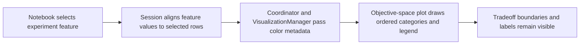

# Stress-Focused FL Notebooks - Plan

## Goal Capsule

- **Objective:** Help FL architecture stakeholders distinguish the observed effect-space patterns associated with stress level from patterns associated with enabled-pattern combinations.
- **Means:** Add generic categorical coloring to ADEPT's quality-objective-space plot and use it in focused image-task notebooks.
- **Authority:** The stakeholder feedback and decisions confirmed in this planning session define the notebook scope; the existing ADEPT APIs, specs, and source CSVs define current behavior and data availability.
- **Stop conditions:** Do not invent results for pattern combinations absent from the compact campaign. Report their support as unavailable.
- **Execution profile:** Code and notebook changes; run the image notebooks in the `perfmodels` conda environment after implementation.

## Product Contract

### Summary

The image-task notebooks will show isolated pattern stress levels with severity-coded colors and add a configurable view of pattern combinations under a fixed client count and stress level. ADEPT will expose a generic categorical-coloring option so other domains can color objective-space points by any suitable experiment variable.

### Problem Frame

The current focal-pattern stress notebooks require one pattern to be ON but allow the other two patterns to vary. Their objective-space charts color points by the eight pattern configurations, so the color communicates pattern combination rather than the stress level under study. This makes the stress comparison harder to read and can mix stress variation with design variation.

The compact campaign also lacks image runs with all three patterns ON and all three stresses at 50%. A useful combined-pattern analysis must make the missing combination visible instead of implying it was observed.

### Requirements

#### Stress-focused image analyses

- R1. Replace the three image focal-pattern stress notebooks with `stress-ONLY` notebooks that require exactly the focal pattern ON and the other two patterns OFF, while pooling client counts and retaining the all-environment view.
- R2. Color the objective-space points by the focal pattern's stress percentage, with ordered labels and colors that progress from green through orange to red as stress increases.
- R3. Use three ordered levels for Client Selector and HDH (25%, 50%, 75%) and five for Message Compressor (0%, 25%, 50%, 75%, 100%).

#### Combined-pattern analysis

- R4. Add an image notebook with configurable client-count and stress-level settings, defaulting to 8 clients and 50% stress, and analyze every non-empty pattern combination represented at that setting.
- R5. Show the support for every non-empty pattern combination, including combinations with no matching rows; do not treat an absent combination as a zero-performance result.
- R6. Keep the existing grouped `partition_seed` train/test procedure and analysis flow, including tradeoff charts, feature importance, PRIM/CART discovery, architectural box explanations, and Markdown box reports.

#### Documentation and outputs

- R7. Update the compact README and stratification guide to describe the new image notebook scopes, defaults, data support, and execution order.
- R8. Regenerate the image notebooks' plots and box reports after implementation, using distinct descriptive names for the new scopes.

### Key Decisions

- **Preserve the first seven image notebooks and focus this change on the three stress notebooks plus one combined-pattern notebook** (session-settled: user-approved — chosen over broader changes to the accepted image notebook set: stakeholders found the first seven useful and singled out the stress analyses).
- **Make the combined-pattern notebook configurable and cover all one-, two-, and three-pattern activation combinations at the chosen setting** (session-settled: user-directed — chosen over limiting analysis to currently supported combinations or waiting for new runs: the comparison should reveal both observed and absent combinations).
- **Keep the text-task notebooks and findings Markdown out of this change** (session-settled: user-approved — chosen over applying the stakeholder changes to both tasks and refreshing findings now: the feedback names the image notebooks, and findings refresh follows completion of notebook rearrangements).

### Success Criteria

- The three stress-only notebooks have legends ordered by the requested stress levels, and each level uses the same color in its notebook across reruns.
- ADEPT's existing default-color and `highlight_policies` behavior remains unchanged.
- At the default combined setting, the notebook reports six supported image configurations (three single-pattern and three two-pattern configurations, 10 rows each across 10 `partition_seed` groups) and visibly reports the three-pattern configuration as absent.
- The notebook run produces charts and box reports that identify the applied filter settings and preserve train/test denominators.

### Scope Boundaries

- This change covers the image task only. The text-task notebooks, their plots, box reports, findings, and synthesis are unchanged.
- The detailed FL campaign and new experiment generation are outside this plan. New runs would be needed to evaluate the all-three-pattern configuration at 50% stress.
- Findings Markdown is deferred until the notebook rearrangements are complete; refresh it later with the `adept-compact-findings` skill in a fresh context.

## Planning Contract

### Key Technical Decisions

- KTD1. **Add domain-neutral categorical coloring to the ADEPT plotting API.** Accept an experiment feature as the point-color grouping and support a caller-supplied palette, category order, legend title, and display labels. The FL notebooks define the stress-specific palette and labels; ADEPT does not encode FL stress semantics. Preserve the existing policy-highlighting path and default scatter color. The current API chain is `ArchSpaceSession` → `ArchSpaceCore` → `VisualizationManager` → `adept.analysis.visualization.show_quality_objective_space()`.
- KTD2. **Keep FL slice semantics in `federatedlearning/fl_slices.py`.** Add a reusable slice option for client count and target stress that keeps configurations with at least one enabled pattern and requires every enabled pattern's stress feature to equal the target. Ignore inactive patterns' missing stress features. This covers every non-empty pattern combination without creating an ADEPT domain dependency.
- KTD3. **Keep discovery pooled at the notebook-slice level.** Do not fit a separate PRIM/CART model for each stress category or pattern combination. Show the per-level or per-configuration support and train/test target counts so each box's evidence remains visible.
- KTD4. **Treat the compact campaign's missing all-three-at-50% case as unavailable evidence.** The current image data at c8/stress 50 contains 60 rows across six configurations and ten seed groups. The seven possible non-empty activation combinations include one absent configuration (`ON,ON,ON`); the current all-three-ON rows use CS=25%, HDH=25%, and MC=0%, 25%, or 100%. The notebook should show this gap explicitly and let other client/stress settings discover availability from the loaded data.

### High-Level Technical Design

The generic color grouping comes from the experiment data selected by `subset` (`all`, `train`, or `test`). The plot applies the caller's category order and palette, then renders a legend title and labels. Existing policy highlighting and default coloring keep their current behavior. FL-specific filters, stress levels, and color mappings stay in the FL notebooks and slicing helper.

### Risks and Dependencies

- Stress-level samples are uneven. In the single-pattern image subsets, each task has 30 rows at the lower levels and 90 rows at the 75% level for Client Selector and HDH; Message Compressor has 30 rows at 0%, 25%, 50%, and 100%, and 90 rows at 75%. Read actual partition and tradeoff counts from each executed notebook before interpreting held-out box metrics.
- Each filtered campaign slice has only ten `partition_seed` groups. A target tradeoff may have little or no held-out support even when the slice contains rows; report it as unevaluable when no held-out targets exist.
- Each pattern-specific stress feature aliases an environment percentage when its pattern is ON. Use the stress feature as the candidate predictor and exclude its paired environment column in the stress-only notebooks to avoid duplicate predictors.
- The combined notebook's stress features do not vary in percentage after filtering. Use configuration as the design alternative and avoid presenting the fixed 50% stress value as an independently varying predictor.
- A generic hue series must stay aligned with the selected experiment and outcome rows after train/test filtering. Define an explicit error when the requested feature is absent or when callers request conflicting policy and generic coloring modes.

## Implementation Units

### U1. Add generic categorical coloring to ADEPT

- **Goal:** Let callers color objective-space points by any categorical experiment feature while preserving the current policy and default plotting behavior.
- **Requirements:** R2, R6
- **Dependencies:** None
- **Files:** `adept/core/session.py`, `adept/core/coordinator.py`, `adept/analysis/visualization_manager.py`, `adept/analysis/visualization.py`, `tests/test_objective_space_categorical_coloring.py`, `tests/test_objective_space_overall_color.py`
- **Approach:** Thread the grouping feature, palette, category order, legend title, and display labels through the existing plotting API. Align values against the requested session subset before drawing. Keep policy highlighting backward compatible and reject an ambiguous simultaneous request for policy and generic coloring.
- **Patterns to follow:** The existing `policy_series` and `palette` path in `adept/analysis/visualization.py`; the current default-color regression test in `tests/test_objective_space_overall_color.py`.
- **Test scenarios:**
  - Pass a categorical feature with an explicit order and palette; verify the legend order and each category's plotted color.
  - Request `subset='train'` and `subset='test'`; verify color categories align with the corresponding experiment and outcome rows.
  - Request a missing feature; verify the API raises a clear validation error.
  - Request generic coloring and `highlight_policies` together; verify the API rejects the conflict with an actionable error.
  - Plot without either coloring option and with `highlight_policies`; verify existing default and policy behavior remains intact.
- **Verification:** The feature tests pass and existing objective-space color tests continue to pass.

### U2. Add configurable FL stress filtering

- **Goal:** Select every pattern combination whose active patterns all use a requested stress percentage, for a selected task and client count.
- **Requirements:** R4, R5
- **Dependencies:** None
- **Files:** `federatedlearning/fl_slices.py`, `tests/test_fl_slices.py`
- **Approach:** Extend the existing `slice_filter` preprocessor after `pattern_stress` parsing. Keep the baseline out of stress-level combination slices, include any configuration with one or more active patterns when all active pattern stress features match the target, and retain a support summary that reports absent activation combinations.
- **Patterns to follow:** Existing task, client, configuration, and environment filtering in `federatedlearning/fl_slices.py`; test style in `tests/test_fl_slices.py`.
- **Test scenarios:**
  - Use rows spanning all eight `config_id` values; with client count 8 and stress 50, retain matching one- and two-pattern rows, exclude nonmatching stress rows and baseline, and report the absent three-pattern combination.
  - Verify patterns set to OFF may have missing stress features without causing a valid row to be dropped.
  - Verify no matching rows raises the existing empty-slice error with the selected filter context.
  - Verify invalid target stress values fail validation before session analysis starts.
- **Verification:** Tests prove the filter conditions and support summary on a small fixture with present and absent combinations.

### U3. Refocus the three image stress notebooks

- **Goal:** Separate each pattern's stress-level view from co-activation with other patterns.
- **Requirements:** R1, R2, R3, R6, R8
- **Dependencies:** U1, U2
- **Files:** Rename `federatedlearning/compact/image/analysis-fl-rq-stress-client_selector-image.ipynb`, `federatedlearning/compact/image/analysis-fl-rq-stress-hdh-image.ipynb`, and `federatedlearning/compact/image/analysis-fl-rq-stress-message_compressor-image.ipynb` to their `stress-ONLY` names; `federatedlearning/compact/image/boxes/`; `federatedlearning/compact/image/plots/`; `tests/test_fl_slices.py`
- **Approach:** Filter to exactly one active pattern, keep client counts pooled and environment all, and color objective-space points by the focal stress feature. Use ordered 25/50/75 labels for Client Selector and HDH; use 0/25/50/75/100 for Message Compressor. Use green, orange, and red as the increasing-severity mapping, with a five-step light-green through dark-red mapping for Message Compressor. Include actual per-level row, target, and partition support in the existing notebook flow. Keep the focal stress feature in feature ranking and PRIM/CART inputs while excluding its paired environment column.
- **Patterns to follow:** The section order and plots/tables/box-report generation in the existing stress notebooks and one-pattern profiles.
- **Test scenarios:**
  - Execute each renamed notebook from top to bottom; verify every row has only the focal pattern ON and every declared stress level appears under the fixed campaign data.
  - Verify category order, labels, and color mappings in each saved objective-space chart.
  - Verify feature ranking and PRIM/CART receive the focal stress feature but not its paired environment alias.
  - Verify split diagnostics and held-out denominators are present, and boxes with zero held-out target support are marked unvalidated.
  - Verify each box report and plot filename names the `stress-ONLY` scope and does not overwrite another notebook's artifact.
- **Verification:** The three notebook outputs, plots, and Markdown box reports correspond to the exact-pattern filters and execute without errors.

### U4. Add the configurable combined-pattern image notebook

- **Goal:** Compare observed one-, two-, and three-pattern activation combinations at a common client count and stress setting.
- **Requirements:** R4, R5, R6, R8
- **Dependencies:** U1, U2
- **Files:** `federatedlearning/compact/image/analysis-fl-rq-combined-patterns-c8-stress-50-image.ipynb`, `federatedlearning/compact/image/boxes/`, `federatedlearning/compact/image/plots/`, `tests/test_fl_slices.py`
- **Approach:** Follow the existing notebook flow. Make client count and target stress level explicit constants with defaults 8 and 50. Use the U2 filter and show a seven-row availability table for all non-empty activation combinations before tradeoff and box analysis. Color the objective-space plot by configuration. Do not fit boxes or calculate performance for combinations with no rows. Exclude fixed task/client fields and avoid using fixed stress features as independent predictors; retain configuration as the design alternative.
- **Patterns to follow:** The all-configuration c8 image notebook for pooled configuration comparisons, and the stress notebooks for pattern-stress explanations and RQ framing.
- **Test scenarios:**
  - Execute with default c8/50 settings; verify 60 rows across six observed configurations and ten seed groups, with all three two-pattern combinations and all three single-pattern configurations represented.
  - Verify the `ON,ON,ON` combination is shown as absent and does not enter the train/test split or discovery metrics.
  - Change either setting to a supported alternative; verify the data filter and artifact names reflect the new values.
  - Verify train and held-out seed groups are disjoint and the report distinguishes zero held-out target support from zero performance.
- **Verification:** The notebook runs successfully at its defaults and its displayed support matrix matches the filtered source rows.

### U5. Update experiment guidance and refresh image artifacts

- **Goal:** Keep the maintained experiment map and generated image outputs consistent with the new notebook scopes.
- **Requirements:** R7, R8
- **Dependencies:** U3, U4
- **Files:** `federatedlearning/compact/README.md`, `federatedlearning/compact/NOTEBOOK_STRATIFICATION.md`, all 11 maintained image notebooks, `federatedlearning/compact/image/plots/`, `federatedlearning/compact/image/boxes/`
- **Approach:** Document the exact-pattern stress filters, ordered palette meanings, configurable combined slice, its missing three-pattern-at-50% support, and image notebook execution order. Execute the maintained image notebooks in `perfmodels` so their outputs, plots, and box reports are current. Leave text-task findings untouched.
- **Test scenarios:**
  - Run all maintained image notebooks; verify none records an execution error.
  - Check every objective-space chart is saved and has the expected data-slice name.
  - Check all updated box reports include the corresponding notebook scope and current discovery/held-out metrics.
  - Compare the documented image notebook count and execution order with files on disk.
- **Verification:** The README and stratification guide describe the image task's 11 notebooks accurately, and regenerated plots/reports match notebook outputs.

## Verification Contract

- Run `conda run -n perfmodels python -m pytest tests/test_objective_space_categorical_coloring.py tests/test_objective_space_overall_color.py tests/test_fl_slices.py`.
- Execute the 11 maintained image notebooks in `federatedlearning/compact/image/` with the `perfmodels` environment.
- Inspect saved legends, plot filenames, availability counts, partition diagnostics, and the 11 image box reports against their notebook filters.
- Confirm the seven existing non-stress image notebooks remain behaviorally unchanged and the text task's notebooks, plots, reports, and findings are untouched.

## Definition of Done

- ADEPT supports generic categorical objective-space coloring and retains its existing policy/default coloring behavior.
- The three renamed image stress-only notebooks isolate their focal pattern and show the requested stress levels with ordered legends.
- The combined-pattern notebook exposes configurable client-count/stress filters and reports absent combinations without assigning them outcomes.
- The image notebook guide and README match the maintained files and data evidence.
- The image notebooks execute in `perfmodels`, and their plots and box reports are refreshed and checked.
- Findings Markdown remains unchanged until a later fresh-context findings refresh.
