# Compact FL campaign — preliminary RQ1/RQ2 observations (for co-author discussion)

*Status: preliminary. Per-notebook case analyses are written and under expert review; the stratification-group syntheses and the per-task synthesis have not been written yet. All numbers below come from the saved notebook outputs, the `boxes/*.md` reports, or recomputation on the two compact CSVs.*

## 1. What was done

1. **Read the 26 maintained notebooks** (13 image, 13 text) from their saved outputs, plus the 26 box reports. The existing `findings/` folder was deliberately not used.
2. **Checked the evidence.**
   - All 163 PRIM/CART boxes in the reports match the notebooks: same targets, rules, held-out counts and lift.
   - The `lift` printed in the notebooks' box summaries is the held-out lift.
3. **Reproduced every slice** with `fl_slices.slice_filter` on the CSVs. Row counts and quadrant counts match all 26 notebooks exactly.
4. **Re-applied every box rule to its slice.** Membership matches the reports exactly (box size and targets in box). Each box can therefore be rewritten in terms of the designed factors.
5. **Added two like-for-like analyses** that the notebooks do not contain:
   - *Matched toggles:* paired runs that differ in exactly one pattern.
   - *Cell-standardized constraint evaluation:* a candidate constraint is compared with all runs of the same environment point and client count.

### Conventions used throughout
- **Grid:** the fixed campaign-wide S/M/L edges, the same for both tasks. Accuracy edges are 0.2075 / 0.4774 / 0.7473 / 1.0172; time edges are 1.5625 / 9.5065 / 17.4505 / 25.3945 s.
- **Target classes:**
  - optimal = **L-S**;
  - acceptable = **M-S, M-M, L-M**;
  - unacceptable = all other quadrants.
- **Tasks** are analysed as separate instances of the problem.
- **Environment points** are written low-spec % / non-IID % / delayed %. For example, 75/25/75 means 75% low-spec, 25% non-IID and 75% delayed clients.
- **Pattern abbreviations:** CS = Client Selector, MC = Message Compressor, HDH = Heterogeneous Data Handler.

## 2. The experimental design constrains every comparison

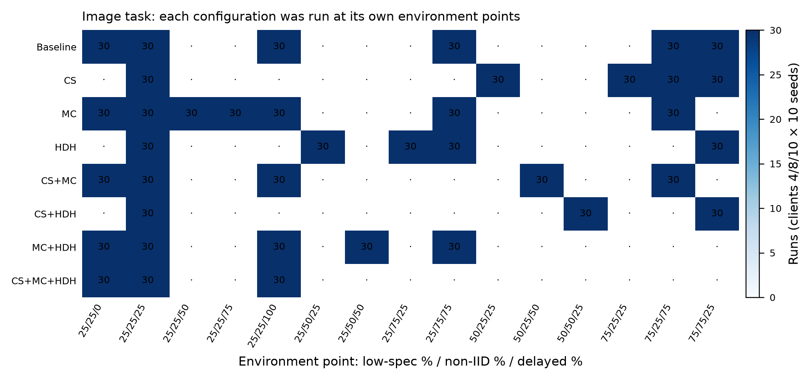

**Rationale for the chart.** Each cell counts the runs of one configuration at one environment point: 30 runs = 3 client counts × 10 seeds. It shows which comparisons are like-for-like. The text-task map is identical, so it is not repeated.

**Observations.**
- Only **25/25/25** is fully crossed (all 8 configurations).
- Three cells contain hidden 2×2 factorials of pattern pairs:
  - 75/25/75: CS × MC;
  - 75/75/25: CS × HDH;
  - 25/75/75: MC × HDH.
- Each pattern's "stress" level **is** the environment factor it is meant to handle: CS ↔ low-spec, MC ↔ delayed, HDH ↔ non-IID. As a result:
  - In the **stress-only** and **combined-pattern 50% / 75%** notebooks, configurations face *different* environments. Their differences are partly differences between environment factors.
  - The **combined-pattern 25%** notebook is exactly the 25/25/25 point minus the baseline, so it is the only like-for-like configuration comparison in that family.
- The `Alpha Dirichlet Mean` and `CPU Mean` features that dominate feature ranking are re-encodings of non-IID share and low-spec share (r = −0.995 for both). `JSD Mean` and `Client Selector Criteria` are NaN exactly when HDH and CS are OFF.

## 3. RQ1 — how decisions and environment allocate runs to quadrants

All objective-space charts below share one layout:
- **Axes:** accuracy (x) against average round time (y) on the full fixed grid. Image and text panels are therefore directly comparable.
- **Shading:** dark gray is the optimal L-S quadrant; light gray is the acceptable set.
- **Points:** each point is one run, colored by the variable the notebook family is designed to vary.
- **Panel titles:** n, the acceptable+optimal share and the L-S share.

### 3.1 All configurations at one client count (c4 / c8 / c10)

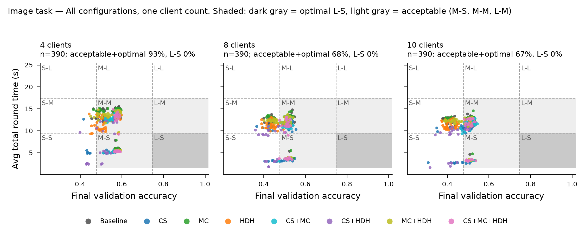

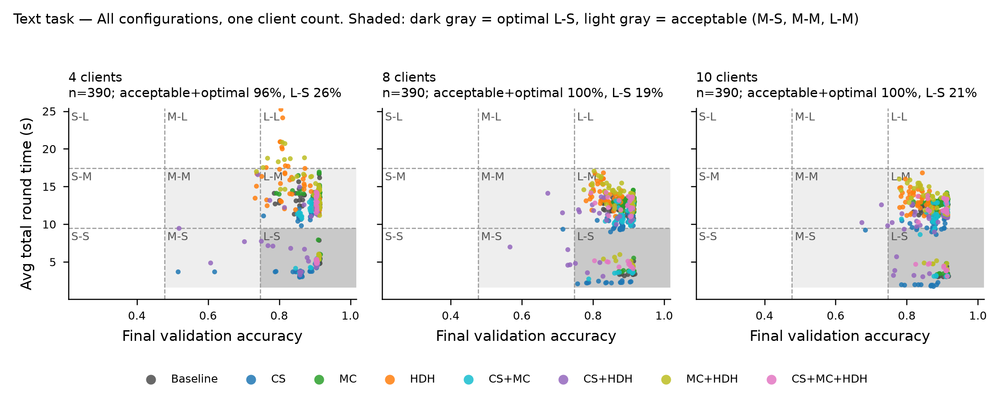

**Rationale.** Holding the client count fixed shows how the eight configurations spread over the quadrants within one deployment size.

**Observations.**
- **Image.** No run reaches L accuracy, so L-S is unreachable.
  - The acceptable share is 93% at 4 clients but 68% / 67% at 8 / 10 clients.
  - Within c8 and c10, the non-IID share decides acceptability: 96% acceptable at 25% non-IID vs 1–2% at 75%.
- **Text.** Accuracy is almost always L (≥ 0.747), so the tradeoff collapses to time: L-S vs L-M.
  - CS-containing configurations hold most of the L-S runs.
  - The few unacceptable runs are L-L. They come from HDH without CS at 4 clients.

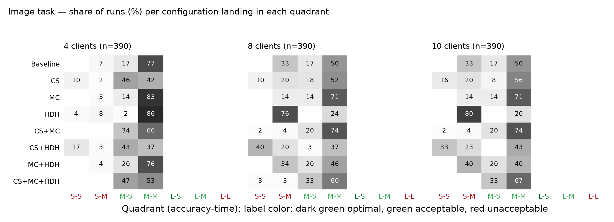

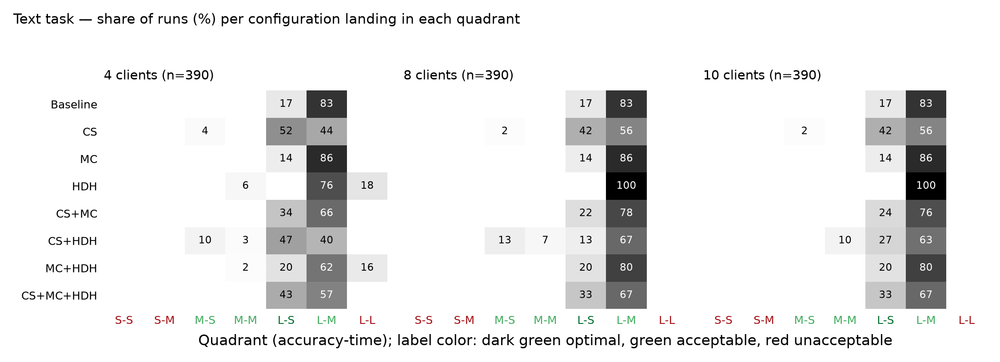

**Rationale.** These heatmaps are the contingency (STARR) view of the same three notebooks. Each row shows how one configuration's runs spread over the quadrants; tick colors mark the target class.

**Caution.** Per-configuration rows still mix pattern and environment effects. For example, the image HDH rows look poor (24% / 20% acceptable at 8 / 10 clients) because HDH was mostly run at non-IID ≥ 50%. Section 3.5 removes this confound.

### 3.2 Isolated pattern stress (stress-only views)

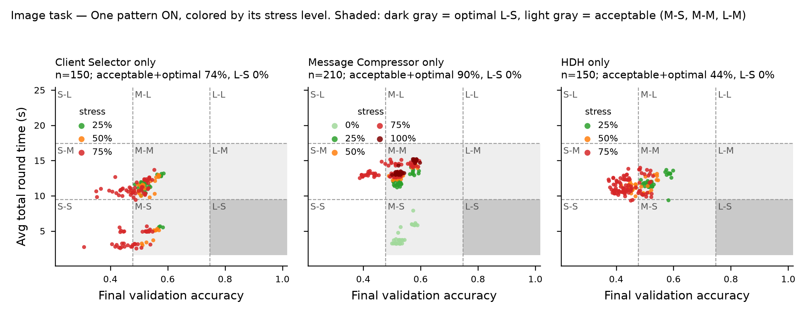

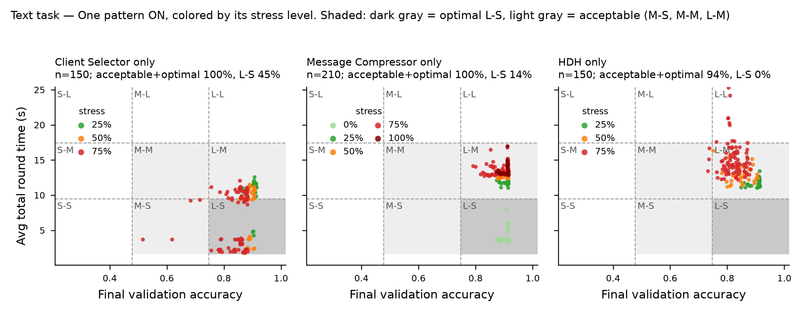

**Rationale.** These views follow each pattern alone as its paired environment factor increases. Colors encode stress severity.

**Observations.**
- **CS stress (low-spec share)** trades accuracy for time.
  - Image: acceptable share 100% → 97% → 58%; mean time 11.2 → 9.3 → 7.8 s.
  - Text: the L-S share rises 10% → 40% → 59%.
- **MC stress (delay share)** only moves runs between M-S/L-S at 0% delay and M-M/L-M at ≥ 25% delay.
  - The image dip at 75% (76% acceptable) comes entirely from one environment point, 25/75/75, whose non-IID share is high.
- **HDH stress (non-IID share).**
  - Image: acceptable 100% → 40% → 27%. This is the non-IID effect; HDH does not offset it.
  - Text: HDH never reaches L-S, and at 75% it produces L-L runs.
- **Twin views.** These views use the same rows and train/test split as the profile notebooks in §3.4. Their boxes are identical apart from one CART box in the text Client Selector pair: L-S at 8 vs 10 clients, caused by a different random-forest feature ranking order between the two views.

### 3.3 Combined patterns at a shared stress level

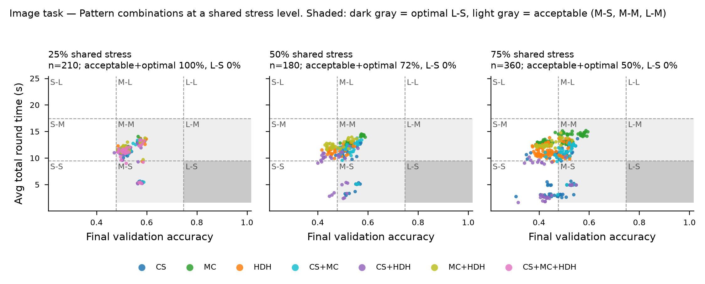

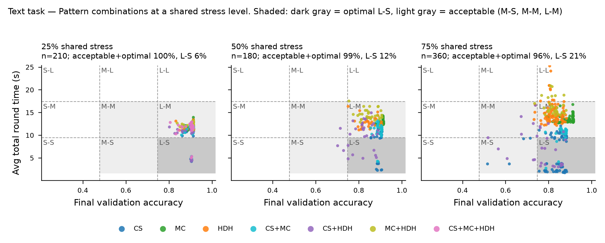

**Rationale.** These notebooks compare single, pair and triple pattern combinations at the same nominal stress. Colors are configurations.

**Observations.**
- **At 25%** (= 25/25/25) every configuration is acceptable: 97–100% for image, 100% for text.
  - Combinations differ only in time.
  - CS-containing configurations are 0.6–1.5 s faster.
  - L-S on text appears only with CS at 4 clients.
- **At 50% / 75%** the "same stress" means different environments per pattern (§2):
  - HDH-containing configurations face high non-IID share.
  - On image they drop to 17–50% acceptable.
  - On text they show L-L runs at 75%: 10% for HDH, 23% for MC+HDH.
- **Client count at 50% / 75% (image).** 4 clients keeps 100% / 82% acceptable vs 52–63% / 34–35% at 8–10 clients.

### 3.4 Single-configuration profiles

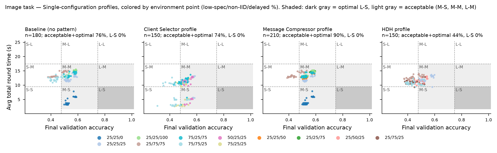

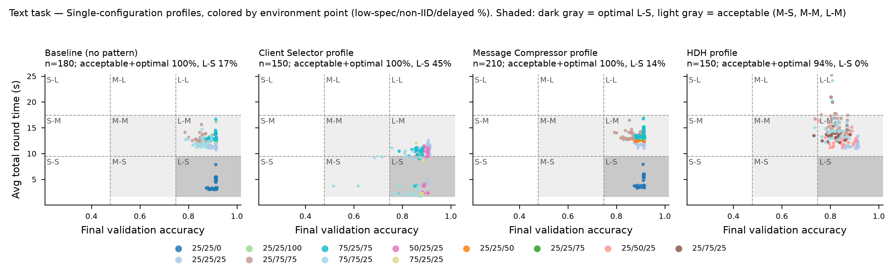

**Rationale.** With one configuration fixed, the remaining spread is caused by the environment and the client count. Colors are environment points.

**Observations.**
- **Baseline.** The quadrant is essentially a function of the environment point:
  - 25/25/0 → M-S (image) or L-S (text);
  - non-IID 75% points → mostly S-M on image.
- **CS profile.** It has the fastest acceptable runs.
  - Text: 45% L-S, up to 83% at 75/25/25.
  - Image: it loses accuracy at 75/75/25 (20% acceptable).
- **HDH profile on text** is the slowest (14.0 s mean) and never reaches L-S.

### 3.5 Like-for-like pattern effects (matched toggles)

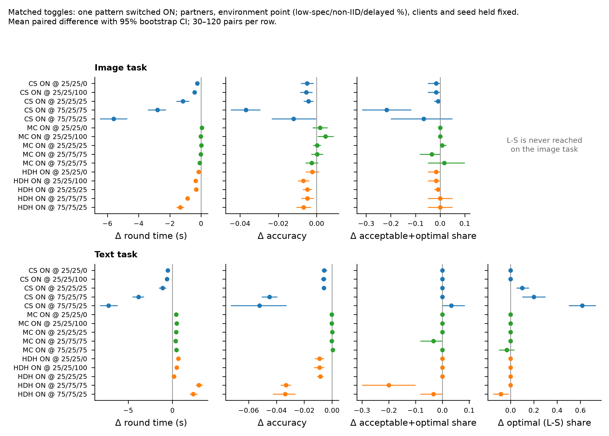

**What "like-for-like" means here.** The per-notebook tables compare configurations that were run at different environment points (§2). Their differences therefore mix two things: the pattern itself and the environment it happened to be tested in.

A matched toggle removes this mixing. It compares two runs that are identical in everything except one pattern being OFF or ON:
- **task;**
- **client count** (4, 8 or 10);
- **environment point** (low-spec / non-IID / delayed %);
- **`partition_seed`** (same data partition and repetition);
- **the states of the other two patterns** ("partners").

Example for "CS ON": pairs are CS vs Baseline, CS+MC vs MC, CS+HDH vs HDH, and CS+MC+HDH vs MC+HDH, wherever both members of the pair were run.

**How to read a row.**
- The label `CS ON @ 75/75/25` means "switch the Client Selector ON, in runs at 75% low-spec, 75% non-IID and 25% delayed clients".
- The three numbers after `@` are the environment point, always in the order low-spec % / non-IID % / delayed %.
- Each row pools all matched pairs available at that point: 30 to 120 pairs, i.e. 3 client counts × 10 seeds × the number of partner combinations run there. Examples:
  - `CS ON @ 25/25/25` has 120 pairs, because all four partner combinations exist at the common point.
  - `CS ON @ 75/75/25` has 60 pairs: CS vs Baseline, and CS+HDH vs HDH.
- Rows are only shown where such pairs exist. This is why, for example, there is no `HDH ON @ 75/25/75`.

**What the columns show.** Each point is the mean paired difference ON − OFF; the bar is its 95% bootstrap confidence interval over pairs.
1. **Δ round time (s).** Negative means faster with the pattern ON.
2. **Δ accuracy.**
3. **Δ acceptable+optimal share:** the fraction of ON runs in the target set minus the fraction of OFF runs.
4. **Δ optimal (L-S) share.** It is blank for image, which never reaches L-S.

A point on the zero line with a narrow bar means the pattern does not move that outcome at that environment point.

**Observations.**
- **CS ON** shortens rounds in both tasks, and the saving grows with the low-spec share: 0.2–1.2 s at 25% low-spec vs 2.8–7.2 s at 75%.
  - Text: L-S share +10 pp at 25/25/25, +20 pp at 75/25/75, +62 pp at 75/75/25.
  - Image: the accuracy cost pushes 22 pp of runs out of the acceptable set at 75/25/75.
- **MC ON.**
  - Image: no effect (|Δacc| ≤ 0.005, |Δtime| ≤ 0.1 s).
  - Text: +0.3–0.5 s per round, consistent with the AP4FED finding that compression adds overhead for small models.
- **HDH ON.**
  - Image: essentially no effect (the README reports HDH work on only 48 of 1,371 non-IID image clients).
  - Text: worse at 75% non-IID — +2.3 to +3.0 s and −0.033 accuracy — and −20 pp acceptable at 25/75/75.
- **Client count** (paired on configuration, environment and seed). On image, 4 vs 8 clients gives +0.056 accuracy and 93% vs 69% acceptable. On text the effect is small.
- **Why this matters for the notebooks.** In the pooled c8/c10 tables, HDH configurations look poor on image (24% / 20% acceptable). The matched toggle shows that HDH ON changes the acceptable share by ≈ 0 pp. The poor share comes from the non-IID levels HDH was tested at.

## 4. RQ2 — which constraints put runs in the target tradeoff

### 4.1 What the discovered boxes actually restrict, and how to prioritize them

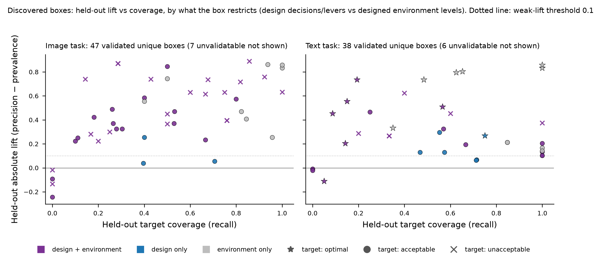

**What the chart does.** It places every distinct box from the 26 box reports on one map of held-out quality. Boxes are counted once: twin views and PRIM/CART boxes with identical membership are merged, leaving 98. Before plotting, each box rule is re-applied to its slice and rewritten in designed factors, which translates the proxies:
- `Alpha Dirichlet Mean` → non-IID %;
- `CPU Mean` → low-spec %;
- `JSD Mean` or `Client Selector Criteria = (not selected)` → the pattern is OFF.

This makes boxes from different notebooks comparable.

**Axes.** Both come from the held-out (test) seeds in the box reports.
- **Coverage (x)** is the share of held-out target runs that fall inside the box: how much of the target the rule explains.
- **Absolute lift (y)** is precision inside the box minus the target prevalence among all test runs of the slice: how much more often the target occurs once the rule is imposed.

**Encoding.**
- **Color** shows what the rule restricts:
  - *design*: pattern ON/OFF states or client count;
  - *environment*: low-spec / non-IID / delayed levels;
  - or both.
- **Marker** shows the target class: star = optimal, circle = acceptable, cross = unacceptable.
- Boxes with no held-out targets cannot be placed and are only counted in the panel title.

**Reading it.**
- Good boxes sit **top-right**: high lift *and* high coverage.
- Boxes at the bottom-left either did not generalize to the held-out seeds or cover very few targets.

**Caveat on raw lift.** Lift is bounded by 1 − prevalence. A perfect box for a common target therefore shows small lift. For example, text L-M has prevalence 0.83–0.87, so the maximum lift is about 0.13–0.17. Ranking by raw lift favors rare targets. The box reports' **test score** corrects this: it is the harmonic mean of
- *normalized enrichment*, (precision − prevalence) / (1 − prevalence), which runs from 0 to 1;
- and coverage.

**Proposed criterion for prioritizing "good" boxes** (applied in order):
1. **Held-out evidence.** The grade is *supported*: at least 3 held-out targets inside the box, precision ≥ 0.5, and lift > 0.10.
2. **Target relevance.** Optimal before acceptable. Discount acceptable-quadrant boxes whose design term mainly selects *away from a better quadrant*. Example: `CS=OFF` in image M-M boxes separates M-M from the equally acceptable, faster M-S.
3. **Quality.** Rank by the reports' test score, not raw lift.
4. **Actionability.**
   - Boxes with a design term are candidate *prescriptions*.
   - Environment-only boxes are *operating envelopes*. They are informative, but the architect cannot enforce them by choosing a configuration.
5. **Confirmation.** The direction of the design term agrees with the like-for-like evidence: the matched toggles (§3.5) and the constraint lifts (§4.2).
6. **Robustness.** The rule recurs across notebooks of the same group, and train and test lift agree.

**Applying the criterion — actionable boxes (supported, optimal or acceptable target, with a design term), ranked by test score.**

*Image:*

| Rank | Notebook / box | Target | Canonical rule | Held-out hits / targets | Precision vs prevalence | Norm. enrichment | Coverage | Test score | Design term confirmed by matched evidence? |
|---:|:---|:---|:---|---:|:---|---:|---:|---:|:---|
| 1 | combined-patterns-stress-50-image / PRIM Box 3 | M-S (acceptable) | CS=ON ∧ MC=OFF ∧ clients∈{4} ∧ low-spec%∈{50} ∧ delayed%∈{25} | 4 / 5 | 0.67 vs 0.09 | 0.63 | 0.80 | 0.71 | Partly — matched toggles: CS ON shortens rounds and 4 clients keep accuracy M; only 5 held-out targets |
| 2 | c8-image / PRIM Box 4 | M-M (acceptable) | CS=OFF ∧ low-spec%∈{25,75} ∧ non-IID%∈{25} ∧ delayed%∈{25,50,75,100} | 33 / 62 | 1.00 vs 0.53 | 1.00 | 0.53 | 0.69 | Partly — `CS=OFF` mainly separates M-M from the faster M-S; as a constraint on the acceptable set it adds only +3 pp |
| 3 | combined-patterns-stress-50-image / CART Box 1 | M-M (acceptable) | MC=ON ∧ delayed%∈{50} | 18 / 34 | 1.00 vs 0.63 | 1.00 | 0.53 | 0.69 | No — MC ON has no matched effect; `MC=ON` stands for “the configuration exposed to 50% delay” |
| 4 | c8-image / PRIM Box 3 | M-S (acceptable) | CS=OFF ∧ low-spec%∈{25} ∧ non-IID%∈{25} ∧ delayed%∈{0} | 9 / 18 | 1.00 vs 0.15 | 1.00 | 0.50 | 0.67 | No — the same environment-only rule (25/25/0) captures 15/16 targets at 10 clients without the CS term |
| 5 | combined-patterns-stress-75-image / PRIM Box 4 | M-M (acceptable) | CS=OFF ∧ MC=ON ∧ HDH=OFF ∧ non-IID%∈{25} ∧ delayed%∈{75} | 18 / 45 | 1.00 vs 0.42 | 1.00 | 0.40 | 0.57 | No — identifies the MC-only configuration at its own stress; MC has no matched effect |
| 6 | c4-image / CART Box 1 | M-M (acceptable) | CS=OFF ∧ HDH=OFF ∧ low-spec%∈{25,75} ∧ non-IID%∈{25} ∧ delayed%∈{25,50,75,100} | 24 / 79 | 1.00 vs 0.68 | 1.00 | 0.30 | 0.47 | Partly — as for c8 PRIM Box 4 |

*Text:*

| Rank | Notebook / box | Target | Canonical rule | Held-out hits / targets | Precision vs prevalence | Norm. enrichment | Coverage | Test score | Design term confirmed by matched evidence? |
|---:|:---|:---|:---|---:|:---|---:|---:|---:|:---|
| 1 | combined-patterns-stress-50-text / CART Box 1 | L-M (acceptable) | clients∈{8,10} | 27 / 47 | 1.00 vs 0.87 | 1.00 | 0.57 | 0.73 | — |
| 2 | c4-text / PRIM Box 4 | L-M (acceptable) | CS=OFF ∧ low-spec%∈{25,75} ∧ delayed%∈{25,50,75,100} | 45 / 79 | 1.00 vs 0.68 | 1.00 | 0.57 | 0.73 | Not useful for the acceptable set — `CS=OFF` selects away from L-S |
| 3 | combined-patterns-stress-75-text / PRIM Box 4 | L-M (acceptable) | CS=OFF ∧ clients∈{8,10} | 42 / 76 | 1.00 vs 0.70 | 1.00 | 0.55 | 0.71 | Not useful — selects the slower L-M region |
| 4 | combined-patterns-stress-75-text / PRIM Box 3 | L-S (optimal) | CS=ON ∧ MC=OFF ∧ low-spec%∈{75} ∧ delayed%∈{25} | 13 / 23 | 0.72 vs 0.21 | 0.65 | 0.57 | 0.60 | Yes — CS ON: +20 pp L-S at 75/25/75, +62 pp at 75/75/25; MC ON adds 0.3–0.5 s per round |
| 5 | client_selector-text / PRIM Box 3 | L-M (acceptable) | clients∈{8,10} ∧ low-spec%∈{25} ∧ non-IID%∈{25} ∧ delayed%∈{25} | 6 / 24 | 1.00 vs 0.53 | 1.00 | 0.25 | 0.40 | — |
| 6 | c4-text / PRIM Box 3 | L-S (optimal) | CS=ON ∧ MC=ON ∧ low-spec%∈{25} ∧ non-IID%∈{25} ∧ delayed%∈{0} | 6 / 31 | 1.00 vs 0.27 | 1.00 | 0.19 | 0.32 | No — 0% delay alone gives L-S (environment-only box captures 15/31); the design term narrows the box |

Two points stand out:
- After step 5, only **one** discovered box is a confirmed design prescription for the optimal quadrant: text `CS=ON ∧ MC=OFF ∧ low-spec 75% ∧ delay 25%`.
- The best environment-only boxes are the reference envelopes. They have test score ≈ 1.0 with up to 15–54 held-out targets:
  - 0% delayed clients → M-S (image) or L-S (text);
  - non-IID 25% with delay > 0 → M-M (image).

**Possible next step.** The acceptable set is spread over three quadrants, so discovery currently splits it into separate targets. Re-running PRIM/CART with a single binary target (acceptable+optimal vs not) and design-only candidate parameters would test directly for design constraints on the target tradeoff.

**Observations on the chart itself.**
- The highest-lift boxes for the best reachable quadrants are environment-only (lift +0.74 to +0.86).
- Design terms appear mostly together with environment terms.
- Design-only boxes (for example `clients ∈ {8,10}`) have low lift: ≤ 0.30, mostly ≤ 0.13.
- Grades — image: 32 supported, 15 weak, 7 unvalidatable; text: 19 supported, 19 weak, 6 unvalidatable.

### 4.2 Candidate design constraints, evaluated like-for-like

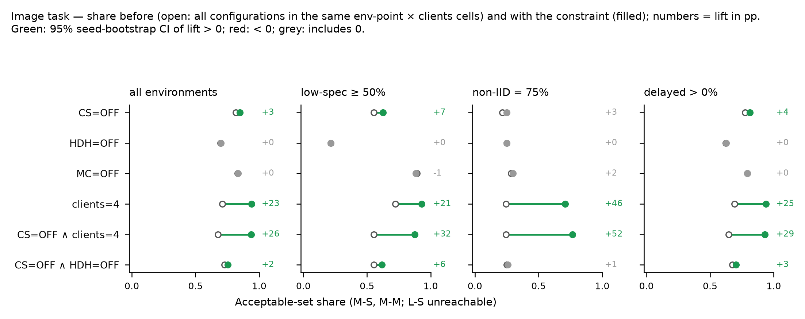

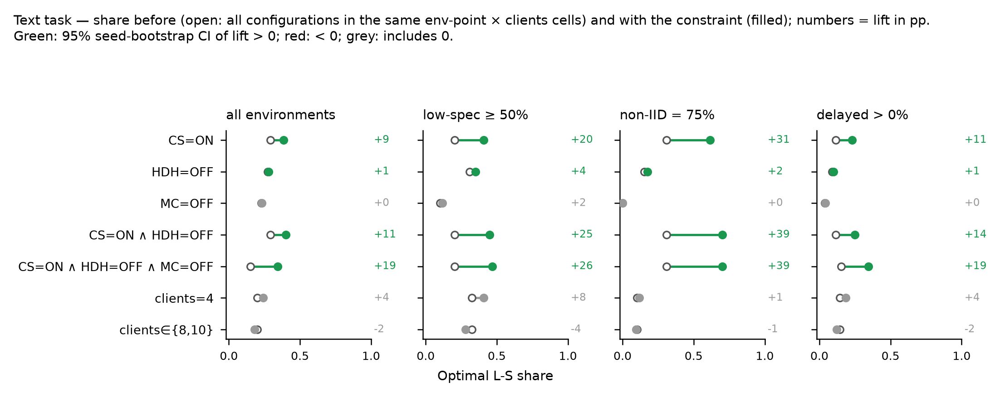

**What "like-for-like" means here.** A box's lift (§4.1) compares the runs inside the box with *all* test runs of the slice. If a box is credited with a high success rate, that may simply be because it keeps a favorable environment.

The constraint evaluation removes this credit:
1. All runs of a task are split into **cells** of identical conditions: environment point × client count.
2. A candidate constraint is a design choice only, for example `CS=ON ∧ HDH=OFF`.
3. Within each cell, the share of target runs among runs that **satisfy** the constraint (filled dot) is compared with the share among **all runs of the same cell** (open dot, the unconstrained baseline).
4. Only cells containing both satisfying and non-satisfying runs are used; cells are averaged with equal weight.

Two consequences:
- **The constraint can only gain from the design choice it imposes**, never from selecting easier environments.
- **For the client-count constraint**, cells are defined by environment point only. For example, `clients=4` is compared with all client counts at the same environment point.

Worked example: text `CS=ON` in the cell 75/75/25 at 8 clients compares the CS and CS+HDH runs with all four configurations run there (Baseline, CS, HDH, CS+HDH).

**How to read the chart.**
- The number at the right of each row is the **lift in percentage points**: share with the constraint − baseline share. It is the same quantity as ADEPT's absolute lift, computed like-for-like on all runs.
- **Color** gives the 95% confidence interval from resampling the 10 partition seeds: green = CI above 0, red = below 0, grey = includes 0.
- **Panels** repeat the evaluation inside operating envelopes (low-spec ≥ 50%, non-IID 75%, delay > 0) to show where a constraint matters most.
- **Metric:** image uses the acceptable-set share (L-S is unreachable); text uses the L-S share (the acceptable set is near 100% everywhere).

**Observations.**
- **Image** (target: the acceptable set):
  - `clients=4` is the one strong design constraint: +23 pp overall, +46 pp at 75% non-IID.
  - Adding `CS=OFF` brings it to +26 / +52 pp.
  - `CS=OFF` alone adds only +3 to +7 pp; HDH and MC constraints add nothing.
- **Text** (target: L-S):
  - `CS=ON ∧ HDH=OFF` gives +11 pp overall, +25 pp at low-spec ≥ 50% and +39 pp at 75% non-IID.
  - `HDH=OFF` also raises the acceptable share at 75% non-IID (+6 pp), because it removes the L-L runs.

## 5. Cross-notebook observations to discuss

1. **Each task occupies a corner of the fixed grid.** Image accuracy spans 0.31–0.60 (S/M only) and text accuracy 0.52–0.92 (mostly L). The question "which decisions reach L-S" is therefore only meaningful for text. For image the realistic question is staying in M accuracy.
2. **The time axis is mainly an environment axis.** 100% of runs with 0% delayed clients are in the fast time bin, versus 11.3% of runs with any delay. CS is the only design decision that moves runs across the time edge.
3. **The accuracy axis on image is a non-IID × client-count axis.** Patterns barely move it; CS can lower it when it excludes many clients.
4. **Pattern-level summaries in the stress-only and combined 50% / 75% notebooks are confounded by design.** Each pattern is stressed through a different environment factor. The matched toggles in §3.5 are the defensible pattern effects.
5. **Feature-importance-driven boxes describe envelopes, not prescriptions.** RQ2 design constraints surface only after translating the proxies and evaluating constraints like-for-like (§4.2).
6. **Pattern interactions are visible only in the 2×2 cells.** For example, the CS time saving is larger with HDH as partner than with MC (3.3 vs 1.2 s on image). These cells sit at different environment points, so interactions and environment cannot be fully separated.

## 6. Caveats and open questions for co-authors

- **Observational data.** "Effects" are paired associations within the sampled design, not causal estimates for new deployments.
- **HDH on image** should be reported as "HDH configured", not "HDH applied" (README A3 / open question 6).
- **`Total Clients` is treated as a design lever**, as the spec declares it. Is the client count a decision the architect controls in the target scenario?
- **Grading thresholds** for weak / supported boxes, and the choice of the acceptable set (M-S, M-M, L-M), shape the RQ2 conclusions and are open to discussion.
- **Grid sensitivity.** The image accuracy edge at 0.477 runs through the main accuracy cluster (23.7% of image runs fall below it), so some quadrant memberships are fragile.
- **Splits.** Five notebooks reported a stratification warning or a fallback to a random split: image HDH twins and image combined-25 (random fallback); text c10 and text combined-50 (warnings). Their held-out metrics are less reliable.

## 7. Supporting files
- Case analyses (under review): `case_analyses_image.md`, `case_analyses_text.md`
- RQ1 tables: `rq1_tables_image.csv`, `rq1_tables_text.csv`, `rq1_matched_toggles.csv`
- RQ2 tables: `rq2_boxes_canonical_image.csv`, `rq2_boxes_canonical_text.csv`, `rq2_constraints_image.csv`, `rq2_constraints_text.csv`
- Checks: `reproduction_check.csv`, `parse_validation.csv`, `evidence_boxes.csv`, `background_notes.md`
