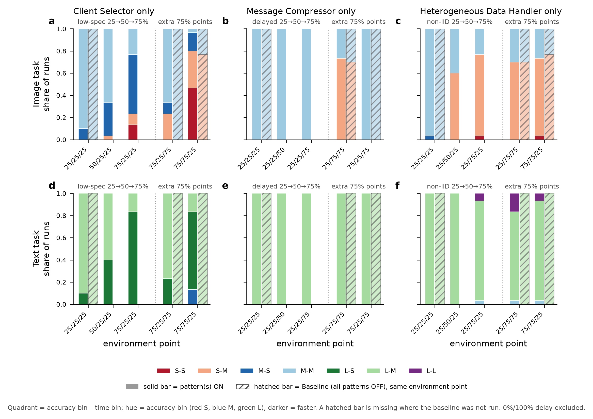
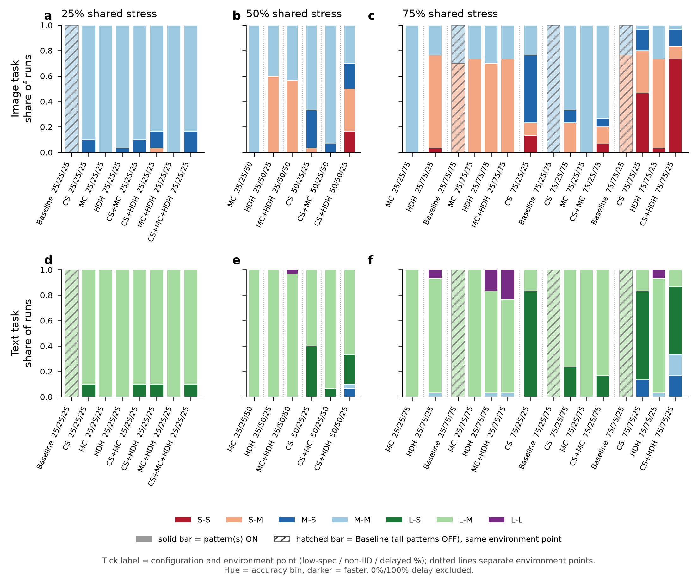
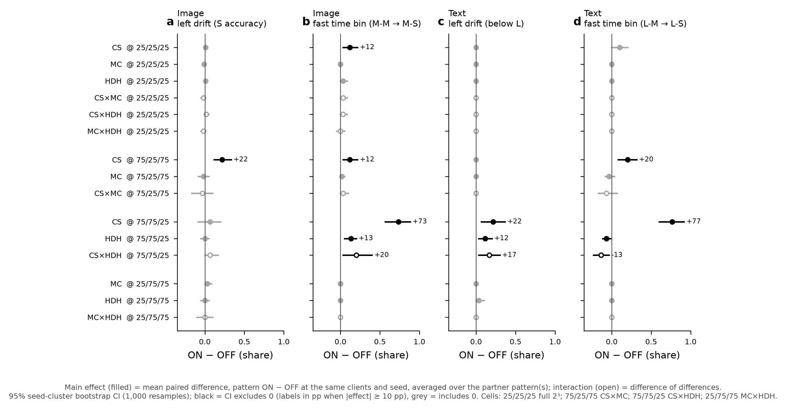
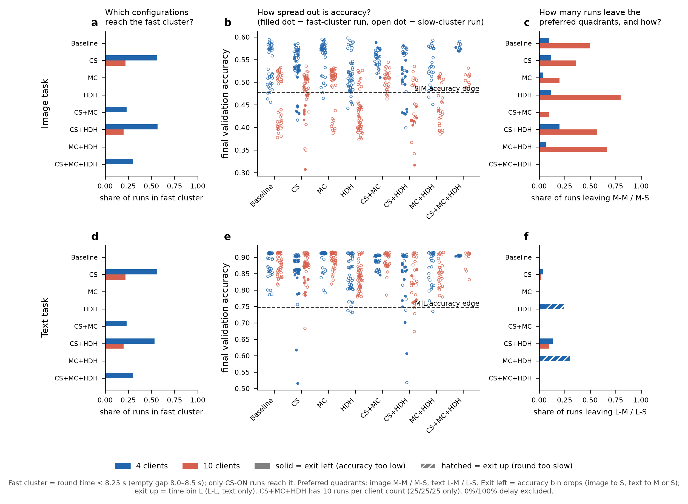

# Compact FL campaign — review 2: RQ1 focus on stress levels, pattern combinations and client count (for co-author discussion)

*Status: preliminary, revision 1 (adds a reading guide, §1.3, and a goal / how-to-read / worked example for every chart). This report follows the first review (`review_preliminary_results.md` (first review bundle), revision 2). It examines three RQ1 views in depth, starting from conjectures formulated after reading that report. All numbers come from recomputation on the two compact CSVs with runs at 0% and 100% delayed clients excluded (870 runs per task).*

## 1. Context and goals

### 1.1 Project goal
The project uses observational data from the AP4FED compact campaign and scenario-discovery techniques (PRIM/CART, ADEPT framework). It asks which architectural decisions and environment conditions of a federated learning system relate to its quality tradeoffs.
- **Decisions:** Client Selector (CS), Message Compressor (MC) and Heterogeneous Data Handler (HDH), each ON/OFF, plus the number of clients (4 / 8 / 10).
- **Environment conditions:** share of low-spec clients, share of non-IID clients and share of delayed clients. They are written as environment points: low-spec % / non-IID % / delayed %.
- **Quality attributes:** final validation accuracy (maximize) and average total round time (minimize). Both are binned on a fixed campaign-wide S/M/L grid. Accuracy edges are 0.477 / 0.747; time edges are 9.51 / 17.45 s.
- **Target classes:** optimal = L-S; acceptable = M-S, M-M, L-M; everything else is unacceptable.
- **Tasks:** image (CIFAR-10 + CNN) and text (AG_NEWS + MLP) are analysed separately.

**RQ1** asks how pattern decisions and environment factors allocate runs to the quadrants of the accuracy × time space.

### 1.2 Goals and conjectures for this review
After the first review, the following sub-questions and conjectures were posed, in this logical order (author's wording):

1. **Isolated patterns by stress level (25 / 50 / 75%), both tasks** (first review §3.2). *Sub-question:* what is the impact of the stress level per pattern type? *Conjecture:* "having a 75% stress level makes configurations drift from optimal or preferred quadrants to the left side of the objective space; while 25% and 50% stress levels keep the configurations mostly in the M-M quadrant."
2. **Combined patterns at a shared stress level** (first review §3.3). *Observation:* "there seems to be a big cluster round M-M and S-M quadrants, and a smaller cluster for the M-S and S-S quadrants." *Sub-question:* "which pattern combinations (or single patterns) make the configurations go to the left, or also move from M-M to M-S."
3. **All configurations at 4 vs 10 clients** (first review §3.1). *Observation:* "there are two clear clusters that tend to have some dispersion." *Sub-question:* "how the pattern combinations (or single patterns) split in the clusters, or how dispersions are influenced, particularly when moving out of the L-M and L-S quadrants (for text task) or out of M-M and M-S quadrants (for image task)."

### 1.3 Reading guide: configurations, environment points and movements in the chart

**Configuration vs environment point.** Every run combines four ingredients:
1. **a configuration**: which patterns are switched ON. There are 8: Baseline (all OFF), CS, MC, HDH, CS+MC, CS+HDH, MC+HDH, CS+MC+HDH;
2. **an environment point**: the conditions the system runs in, described by three percentages of the clients;
3. **a client count**: 4, 8 or 10;
4. **a seed** (10 repetitions).

**An environment point is not a configuration.** It is written as three numbers, always in the same order:

| Written as | Low-spec clients | Non-IID clients | Delayed clients | Meaning |
|:---|---:|---:|---:|:---|
| 25/25/25 | 25% | 25% | 25% | the mildest point; every configuration was run here |
| 75/25/75 | 75% | 25% | 75% | many weak clients and many delayed clients, data mostly IID |
| 75/75/25 | 75% | 75% | 25% | many weak clients and mostly skewed (non-IID) data |
| 25/75/75 | 25% | 75% | 75% | mostly skewed data and many delayed clients |

- *Low-spec*: clients with little CPU (slow training).
- *Non-IID*: clients whose local data has a skewed class distribution.
- *Delayed*: clients whose messages arrive late.

For example, "CS at 75/25/75" means the Client Selector ON, in a federation where 75% of the clients are low-spec, 25% have non-IID data and 75% are delayed.

**Stress level.** In the notebooks, each pattern's "stress level" is the share of the environment factor that pattern is meant to handle:
- CS ↔ low-spec %;
- MC ↔ delayed %;
- HDH ↔ non-IID %.

"CS at 75% stress" therefore means CS ON at any point whose first number is 75: 75/25/25, 75/25/75 or 75/75/25. These are three different environments. This is why the report always shows results per environment point.

**Movements in the accuracy × time space** (panel b above). The x-axis is the accuracy bin (S / M / L, higher is better); the y-axis is the round-time bin (S / M / L, lower is better).
- **Left drift:** the accuracy bin drops, i.e. the run moves left. On image this means falling to S accuracy (< 0.477); on text it means falling out of L (< 0.747).
- **Down (fast):** the time bin becomes S (< 9.51 s), i.e. the run moves down. This is M-M → M-S on image and L-M → L-S on text.
- **Up:** the time bin becomes L (> 17.45 s), i.e. the run moves up. This only happens on text (L-M → L-L).
- **Preferred quadrants:** image M-M and M-S (L accuracy is never reached on image); text L-M and L-S.
- **Exit:** a run is *not* in the preferred quadrants. It exits *left* when its accuracy is too low, and *up* when its round is too slow.
- **Fast cluster:** runs with round time < 8.25 s, i.e. below an empty gap in the round-time distribution (8.0–8.5 s). It is a visible group of points near the bottom of the charts and is slightly stricter than the 9.51 s quadrant edge.

## 2. How the conjectures were tested

The campaign design is not crossed: each configuration was run only at some environment points. Each pattern's "stress" level *is* its paired environment factor (CS ↔ low-spec, MC ↔ delayed, HDH ↔ non-IID). A raw comparison between stress levels or between configurations therefore mixes pattern effects with environment effects. Four devices separate them:

1. **Clean series vs extra points** (conjecture 1).
   - In the stress-only views, the 75% level pools three environment points.
   - The *clean series* varies only the pattern's own factor (25 → 50 → 75%) with the other two factors at 25%.
   - The two *extra 75% points* also raise a second factor to 75%.
2. **Baseline counterpart.** Wherever the baseline (all patterns OFF) was run at the same environment point (25/25/25, 75/25/75, 75/75/25, 25/75/75), the pattern's own contribution is ON − baseline at that point, paired by client count and seed.
3. **Factorial cells** (conjecture 2). Four environment cells contain every combination of the patterns involved plus the baseline:
   - 25/25/25 (full 2³);
   - 75/25/75 (CS × MC);
   - 75/75/25 (CS × HDH);
   - 25/75/75 (MC × HDH).

   Within them, main effects and pairwise interactions are estimated from paired runs, with 95% seed-cluster bootstrap CIs (1,000 resamples). The 50% shared-stress level has no such cell and is read descriptively.
4. **Cluster mechanism, exits and variance split** (conjecture 3).
   - The fast cluster is explained from the client-selection data.
   - Exits are attributed to configuration and environment point.
   - Each configuration's accuracy variance is split into between-environment-point and within-point (seed) parts.

## 3. Two mechanisms behind the clusters

These two mechanisms recur in all three conjectures, so they are stated first.

**Time: the fast cluster is a delayed-client lottery that only CS can enter.**
- The Client Selector is resource-based with a CPU threshold of 7, so it keeps only the high-spec clients (CPU 12). At 4 clients and 75% low-spec, for example, a single client trains.
- The fast cluster contains **only CS-ON runs**: 95 image and 94 text runs, against 0 with CS OFF.
- A run is fast when **none of the selected clients is a delayed client**. Evidence:
  - fast/slow status is fixed by the seed: it agrees in 179 of 180 groups that share clients, environment point and seed across CS configurations, and in 99.7% of runs across the two tasks;
  - the observed number of fast runs (189) matches the probability that a random selection contains no delayed client: 192.6 expected; r = 0.96 across 15 client / participant / delayed-count groups ([rq1_focus_fast_cluster_mechanism.csv](tables/rq1_focus_fast_cluster_mechanism.csv)).
- Fast odds therefore rise when fewer clients are selected (more low-spec clients, fewer total clients) and fall when more clients are delayed.
- A second, smaller time effect: excluding slow low-spec clients shifts the *slow* cluster down by 1–3 s. On text this crosses the 9.51 s edge for some CS runs at 75% low-spec. Those runs count as L-S but are not in the fast cluster.
- At the same configuration and environment point, fast-cluster runs are not less accurate than slow-cluster runs (median difference within ±0.01).

**Accuracy: non-IID share sets two bands; client count and CS move them.**
- Image accuracy splits into an upper band (non-IID 25%) and a lower band (non-IID ≥ 50%).
  - At 10 clients the lower band lies below the S|M edge: mean 0.443 / 0.407 at non-IID 50 / 75%, so 93% / 98% of those runs are S.
  - At 4 clients everything sits 0.06–0.08 higher. The non-IID 75% band (mean 0.489) straddles the edge, so only 29% of those runs are S.
- CS lowers accuracy when it trains on few clients (75% low-spec): −0.037 to −0.052 against the baseline at 75/25/75 and 75/75/25.

## 4. Conjecture 1 — stress level per pattern

**Goal of the chart.** It answers two questions for each pattern used alone:
1. As its stress level rises, to which quadrants do the runs move?
2. Is that movement caused by the pattern, or would it happen anyway in that environment?

**How to read it.**
- **One panel per pattern and task**: columns are CS, MC and HDH; rows are image and text.
- **One bar position per environment point.**
  - The first three positions are the pattern's *clean series*: only its own factor rises, 25 → 50 → 75%, with the other two factors at 25%.
  - After the dotted line come the *two extra 75% points*, where a second factor is also at 75%. These five points are exactly where the notebook ran that pattern alone.
- **Each bar is stacked** from the 30 runs at that point (3 client counts × 10 seeds). Each colored segment is the share of those runs in one quadrant. Hue gives the accuracy bin (red S, blue M, green L); darker means faster.
- **Solid bar = the pattern ON** at that environment point.
- **Hatched bar (diagonal stripes) = the Baseline** (all three patterns OFF) at the *same* environment point. It is the reference: what the system does in that environment without the pattern.
  - If the solid and hatched bars look alike, the pattern does not change the outcome there; any drift comes from the environment.
  - If they differ, the difference is the pattern's own effect.
  - Where no hatched bar appears, the campaign did not run the baseline at that point, so the pattern and environment effects cannot be separated there.

**Worked example (panel a, image, Client Selector).** At 75/25/75 the solid bar has 23% light-red (S-M) runs, while the hatched baseline bar is entirely light blue (M-M). The baseline in the same environment does not drift left, so the Client Selector causes this left drift. At 75/75/25 both bars have a large red part (≈ 80% vs ≈ 77% S accuracy), so there the left drift comes from the environment (75% non-IID), not from CS.

**Observations.**
- **Client Selector (low-spec stress).**
  - Image, clean series: the main drift is *down*, not left. M-S rises 10% → 30% → 53% and mean time falls 11.2 → 9.3 → 6.3 s. Left drift appears only at 75% (23% S accuracy; mean accuracy 0.535 → 0.529 → 0.501).
  - Image at 75/25/75: 23% of runs drift left against 0% for the baseline, so this drift is caused by CS. Only 10% are fast, because 75% delay makes it unlikely that the selected clients avoid every delayed one.
  - Image at 75/75/25: 80% are left, but the baseline is already 77% left (non-IID 75%). Combined with 63% fast runs this gives 47% S-S.
  - Text: the drift is downward into the optimal quadrant, L-S 10% → 40% → 83%. Accuracy falls (0.901 → 0.861) but stays L. Left drift appears only at 75/75/25 (13% M-S; baseline 0%). At 75/25/75 L-S is only 23%, again because of the delay share.
- **Message Compressor (delay stress).**
  - No drift along the clean series: image 100% M-M, text 100% L-M.
  - Mean time rises with delay: image 12.3 → 13.2 → 13.6 s; text 12.1 → 13.0 → 13.4 s. MC itself adds 0.3–0.5 s on text and nothing on image.
  - The only left drift (image 25/75/75, 73% S-M) is environmental: the baseline there is 70% S-M.
- **Heterogeneous Data Handler (non-IID stress).**
  - Image: left drift already at **50%** (60% S-M) and 77% at 75%. The baseline drifts by the same amount at 25/75/75 and 75/75/25 (70% / 77%), so this is the non-IID effect; HDH neither causes nor prevents it.
  - Text: no left drift (≤ 3%). Accuracy decreases within L (0.898 → 0.847 → 0.821) and runs drift *up*: L-L 7% at 25/75/25 and 17% at 25/75/75. Against the baseline HDH adds +2.7 to +3.1 s and −0.033 accuracy, so on text the upward drift is caused by HDH.

**Verdict on conjecture 1: partly supported.**
- **Image:** the conjecture holds at 25% (runs stay in M-M, or 10% M-S for CS) and at 75% (all three patterns drift left). But the reasons differ: CS drifts through its own client exclusion; HDH and MC drift because of the non-IID environment of the points they were run at. HDH already drifts left at **50%**.
- **CS's dominant stress effect is downward** (faster rounds) in both tasks; left drift is added only at 75%.
- **Text:** the conjecture does not hold. Stress mostly moves runs vertically: CS down into L-S, HDH up toward L-L, MC not at all. Left drift is rare (≤ 13%).

## 5. Conjecture 2 — combined patterns at a shared stress level

**Goal of the chart.** It shows, for each shared stress level, which pattern combinations end up in which quadrants. It also separates what the combination does from what its environment does.

**How to read it.**
- **Panels:** one per shared stress level (columns 25 / 50 / 75%) and task (rows).
- **Bars:** each bar is one configuration at one environment point. Both are written in the tick label, e.g. `CS+HDH 75/75/25`. The bar is stacked by quadrant exactly as in the conjecture 1 chart.
- **Grouping:** dotted lines separate environment points. Bars between two dotted lines ran under identical conditions and can be compared directly.
- **Different environments per configuration.** At the same "shared stress", different configurations run in different environments, because each pattern's stress is a different factor. At 50%, for example, CS runs at 50/25/25 but CS+HDH at 50/50/25.
- **Hatched bar (diagonal stripes) = the Baseline** (all patterns OFF) at the same environment point. It appears at the start of a group only where the campaign ran the baseline there (25/25/25, 25/75/75, 75/25/75, 75/75/25). Comparing a configuration's solid bar with the hatched bar of its group shows how much of its quadrant mix would be there anyway.

**Worked example (panel c, image, 75%).** In the 25/75/75 group, the hatched baseline bar and the MC, HDH and MC+HDH bars all have ≈ 70–73% light-red (S-M) runs. The left drift is therefore the same with or without these patterns: it comes from 75% non-IID. In the 75/75/25 group, CS+HDH has 73% dark-red (S-S) runs, while the baseline has none in S-S. The two patterns together move runs down into the fast-but-inaccurate S-S quadrant.

**Goal of the chart.** It puts a number with a confidence interval on the effect of switching each pattern ON. It uses only comparisons where everything else is equal. This answers "which patterns move runs left?" and "which patterns move runs from M-M to M-S?".

**How to read it.**
- **Where the comparisons come from.** Only four environment points contain every combination of the patterns involved together with the baseline:
  - 25/25/25 (all 8 configurations);
  - 75/25/75 (Baseline, CS, MC, CS+MC);
  - 75/75/25 (Baseline, CS, HDH, CS+HDH);
  - 25/75/75 (Baseline, MC, HDH, MC+HDH).
- **Rows.** Each row is one effect at one of these points, e.g. `CS @ 75/25/75` is the effect of switching CS ON at 75/25/75.
  - A **filled dot** is a main effect: the change in share when the pattern is switched ON, comparing runs with the same client count and seed, averaged over the states of the other pattern(s).
  - An **open dot** is an interaction, e.g. `CS×HDH`: how much more (or less) the two patterns do together than the sum of their separate effects.
- **Columns.**
  - Columns a and c measure left drift: the change in the share of runs below the accuracy edge.
  - Columns b and d measure the move down: the change in the share of runs in the fast time bin.
- **Values.** The horizontal line is the 95% confidence interval. A value of +0.22 means +22 percentage points.
  - **Black** = the interval excludes zero (a clear effect; values ≥ 10 pp are labelled).
  - **Grey** = no clear effect.

**Worked example.** Row `CS @ 75/25/75`, column a (image, left drift) shows +22 in black. At 75/25/75, switching CS ON raises the share of S-accuracy runs by 22 percentage points compared with the same runs without CS. Row `MC @ 75/25/75` is grey and at zero: MC changes nothing there.

**Observations — which patterns move runs left?**
- **Image:**
  - only **CS** moves runs left by itself: +22 pp S accuracy at 75/25/75;
  - at 75/75/25 the environment already puts 77% of baseline runs in S, and CS adds a non-significant +7 pp;
  - MC and HDH have no left effect in any cell;
  - the large left shares of HDH and MC+HDH (50%, 75%) and of MC at 25/75/75 are environmental (non-IID ≥ 50%).
- **Text:** left drift needs **CS together with HDH at high non-IID**. At 75/75/25: CS +22 pp, HDH +12 pp, CS×HDH interaction +17 pp. CS+HDH reaches 33% M-accuracy runs (M-M 17%, M-S 17%).

**Observations — which patterns move runs from M-M to M-S (L-M to L-S)?**
- Only **CS**:
  - image: +12 pp in the fast time bin at 25/25/25 and at 75/25/75, +73 pp at 75/75/25;
  - text: +20 pp at 75/25/75, +77 pp at 75/75/25.
- MC has no effect anywhere.
- The delay share is the brake.
  - CS's fast-cluster share drops from 63% at 75/25/25 to 10% at 75/25/75.
  - CS+MC at 50/25/50 reaches only 7% M-S, vs 30% for CS at 50/25/25.
  - CS+MC therefore looks "slow" because its environment has more delayed clients, not because of MC (the CS×MC interaction is ≈ 0).
- HDH interacts with CS in opposite directions on the two tasks:
  - image: HDH shortens rounds slightly, and CS×HDH adds +20 pp to the fast time bin at 75/75/25;
  - text: HDH adds ≈ 2–3 s, and CS×HDH removes −13 pp.

**Verdict on conjecture 2: the two-cluster reading is confirmed for image and explained.**
- The **small M-S/S-S cluster is the CS fast cluster** (§3). Which quadrant it lands in is set by the environment: non-IID 75% → S-S (CS+HDH 73% S-S at 75/75/25), non-IID 25% → M-S (CS 53% M-S at 75/25/25).
- The **large M-M/S-M cluster** is everything else. It is split by non-IID share, not by pattern choice.
- **Going left:**
  - image: CS alone (at 75% low-spec);
  - text: CS × HDH at high non-IID;
  - the leftward shares of HDH/MC configurations reflect the non-IID levels they were tested at.
- **Moving M-M → M-S:** CS only, limited by the delay share.

## 6. Conjecture 3 — all configurations at 4 vs 10 clients

**Goal of the chart.** In the first review's client-count charts (§3.1), each panel shows two groups of points:
- a large **slow cluster** around 10–15 s;
- a small **fast cluster** below ≈ 8 s.

This chart takes the 4- and 10-client panels apart, one configuration at a time, to answer three questions (one per column):
1. *Which configurations end up in the fast cluster?*
2. *How spread out are they on accuracy, and does that spread cross the accuracy edge?*
3. *How many runs leave the preferred quadrants, and in which direction?*

**How to read it.**
- **Rows and colors:** rows are tasks; blue = 4 clients, red = 10 clients.
- **Column 1 (a, d):** for each configuration, the share of its runs in the fast cluster (round time < 8.25 s). A missing bar means the configuration never reaches it.
- **Column 2 (b, e):** every run is a dot, placed by its accuracy. **Filled dots** are fast-cluster runs; **open circles** are slow-cluster runs. The dashed line is the accuracy edge of the preferred quadrants (image 0.477 between S and M; text 0.747 between M and L). Dots below the line have drifted left.
- **Column 3 (c, f):** the share of a configuration's runs that are *not* in the preferred quadrants (image M-M / M-S; text L-M / L-S). Such a run has "exited", and it can exit in two directions:
  - **left** (solid part of the bar): its accuracy fell below the edge. On image it lands in S-M or S-S; on text in M-S, M-M or below.
  - **up** (hatched part of the bar): its round time exceeded 17.45 s, so it lands in L-L. This only happens on text.

**Worked example (image).** In column 3, the HDH row shows a short blue bar (12% exits at 4 clients) and a long red bar (80% at 10 clients); both are solid, i.e. left exits. In column 2, the HDH open circles at 10 clients sit mostly below the dashed line (≈ 0.38–0.45). In column 1, HDH has no bar: HDH runs never reach the fast cluster. With 10 clients, HDH runs therefore leave M-M by losing accuracy, and they never move down to M-S.

**Observations — how configurations split between the clusters.**
- Only CS-containing configurations reach the fast cluster.
  - At 4 clients: CS 56%, CS+HDH 57% (image) / 53% (text), CS+MC+HDH 30%, CS+MC 23%.
  - At 10 clients: CS 22%, CS+HDH 20%, CS+MC and CS+MC+HDH 0%.
  - With 4 clients CS often keeps only 1–2 clients, and a small selection is more likely to contain no delayed client.
- Cluster positions:
  - Image, 4 clients: fast cluster ≈ 4.8 s with mean accuracy 0.524 (82% M-S); slow cluster ≈ 13.1 s with accuracy 0.541.
  - Image, 10 clients: fast cluster ≈ 2.6 s but accuracy 0.433 (82% S-S); slow cluster ≈ 11.6 s with accuracy 0.471.
  - Text: fast clusters ≈ 4.4 / 2.6 s with accuracy 0.846 / 0.832 at 4 / 10 clients; 93% / 100% L-S.
  - On image, therefore, 10 clients turns the fast cluster from acceptable into unacceptable. The lower accuracy comes from the high-low-spec, high-non-IID points where fast runs occur, not from being fast.

**Observations — how runs leave the preferred quadrants.**
- **Image (out of M-M / M-S):** exits are always leftward.
  - At 4 clients 0–20% of a configuration's runs exit (CS+HDH 20%, CS and HDH 12%, baseline 10%).
  - At 10 clients exits range from 10% to 80% (HDH 80%, MC+HDH 67%, CS+HDH 57%, baseline 50%, CS 36%).
  - By environment point at 10 clients, every run exits at 25/50/25, 25/50/50, 25/75/25 and 25/75/75, and 95% at 75/75/25, whatever the configuration ([rq1_focus_exits_by_env.csv](tables/rq1_focus_exits_by_env.csv)). Configuration-level differences therefore mirror the non-IID levels each configuration was run at.
  - CS-specific exits are the runs at non-IID 25% with 75% low-spec (40% at 75/25/25, 18% at 75/25/75, 10 clients).
- **Text (out of L-M / L-S):**
  - exits upward (L-L) occur only at 4 clients with HDH: MC+HDH 27%, HDH 18%, concentrated at 25/75/75 (30% of runs there);
  - exits leftward come mainly from CS+HDH (13% at 4 clients, 10% at 10 clients, at 75/75/25);
  - at 10 clients no run exits upward.

**Observations — what drives the dispersion** ([rq1_focus_clients_clusters.csv](tables/rq1_focus_clients_clusters.csv)).
- Accuracy spread within a configuration is mostly *between environment points*.
  - Image: 77–94% of the variance for configurations without CS, 45–73% for CS-containing ones. CS adds seed-level spread on top, because which clients are selected varies by seed.
  - Text: 51–77% without CS; with CS the share ranges more widely (CS alone 44–46%, CS+HDH 36–51%).
- Time spread inside the slow cluster is largest for HDH configurations on text at 4 clients: SD 3.2 s for HDH and 2.7 s for MC+HDH, vs ≈ 1.0 s or less without HDH. It shrinks at 10 clients (1.5 s). This is the dispersion that pushes text runs over the 17.45 s edge.

**Verdict on conjecture 3: the two clusters are confirmed and identified.**
- **The clusters are fast vs slow, not configuration families.** Only CS configurations populate the fast cluster. For CS and CS+HDH it is 2.5–3 times more frequent at 4 clients; CS+MC and CS+MC+HDH reach it only at 4 clients.
- **Image dispersion along accuracy is environmental** (non-IID share). Going from 4 to 10 clients shifts the accuracy bands down by 0.06–0.08, enough to push the non-IID ≥ 50% band entirely out of M.
- **Text runs leave L-M/L-S mainly upward**, through HDH's time overhead at 4 clients. They leave leftward through CS+HDH at 75/75/25.

## 7. Summary of verdicts

| # | Conjecture / sub-question | Verdict | Key evidence |
|:---|:---|:---|:---|
| 1 | 75% stress drifts configurations left; 25% and 50% keep them in M-M | Partly supported: image yes at 75%, but HDH already at 50%; text no | CS drifts left by itself (+23 pp at 75/25/75) and mainly drifts *down*; HDH/MC left drift equals the baseline's at the same point; text: CS → L-S, HDH → L-L |
| 2 | Which combinations go left or move M-M → M-S | Left: CS alone (image), CS×HDH (text); M-M → M-S: CS only, braked by delay share | Factorial effects: CS +22 pp left at 75/25/75 (image); CS×HDH +17 pp left (text); CS +12 to +77 pp fast; MC ≈ 0 everywhere |
| 3 | How configurations split in the two clusters, and what drives dispersion and exits | Fast cluster = CS + no delayed client selected; dispersion mostly environmental | Fast cluster CS-only (observed 189 vs 192.6 expected); image exits ≈ 100% at non-IID ≥ 50% with 10 clients; text exits = HDH time at 4 clients |

## 8. Implications to discuss

1. **For RQ2, CS is the only design lever on the time axis.** Its benefit is probabilistic. It depends on how many clients it keeps and on the share of delayed clients. A delay-aware selection criterion (not only CPU) would be the natural design alternative to test.
2. **The accuracy axis on image is an environment × client-count axis.** No pattern combination protects accuracy against non-IID ≥ 50%. HDH does not either, consistent with HDH being "configured, not applied" for most image clients.
3. **On text, HDH is a cost, not a benefit:** +2–3 s per round and −0.03 accuracy at high non-IID, and the source of all 17 L-L runs (HDH 9, MC+HDH 8).
4. **Stress-level summaries in the stress-only and combined notebooks should always be read per environment point.** The pooled 75% level mixes the pattern's own factor with a second stressed factor.

## 9. Caveats and open questions

- **Observational, non-crossed design.** Like-for-like statements rely on the four complete cells and on baseline counterparts at the same point. The 50% shared-stress comparisons are descriptive.
- **Fast-cluster mechanism.** The 8.25 s cut is a gap in the data, not a quadrant edge. The hypergeometric check assumes delayed clients are assigned at random among all clients. Can the campaign README or code confirm the actual assignment rule?
- **Small cells.** After the exclusion CS+MC+HDH has 10 runs per client count (25/25/25 only). Many exit shares of 10–30% rest on 3–9 runs.
- **HDH on image** is "configured, not applied" for most non-IID clients (first review §6). Its small image effects, such as slightly shorter rounds, should be read with that in mind.
- **Open question:** should the fast-cluster membership (no delayed client selected) be treated as an environment outcome or as part of the CS decision when formulating RQ2 constraints?

## 10. Supporting files

- Figures: [review2_reading_guide.png](figures/review2_reading_guide.png), [rq1_focus_stress_drift.png](figures/rq1_focus_stress_drift.png), [rq1_focus_combined_quadrants.png](figures/rq1_focus_combined_quadrants.png), [rq1_focus_factorial_effects.png](figures/rq1_focus_factorial_effects.png), [rq1_focus_clients_clusters.png](figures/rq1_focus_clients_clusters.png)
- Tables: [rq1_focus_stress_levels.csv](tables/rq1_focus_stress_levels.csv), [rq1_focus_combined_levels.csv](tables/rq1_focus_combined_levels.csv), [rq1_focus_factorial_effects.csv](tables/rq1_focus_factorial_effects.csv), [rq1_focus_clients_clusters.csv](tables/rq1_focus_clients_clusters.csv), [rq1_focus_exits_by_env.csv](tables/rq1_focus_exits_by_env.csv), [rq1_focus_fast_cluster_mechanism.csv](tables/rq1_focus_fast_cluster_mechanism.csv)
- First review (context): `review_preliminary_results.md` (first review bundle)
