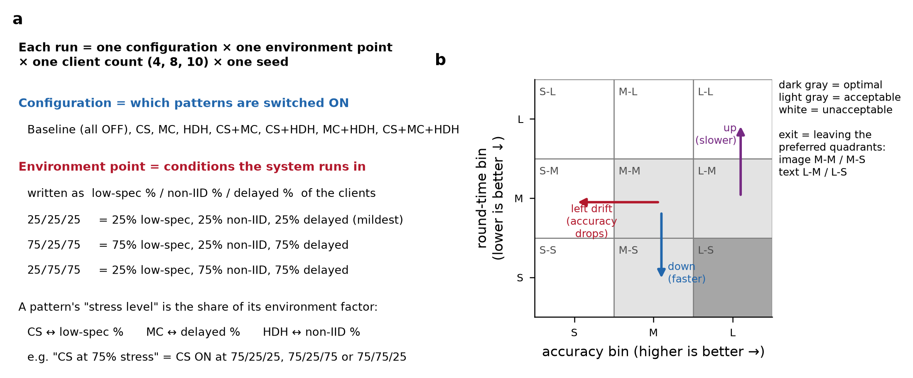
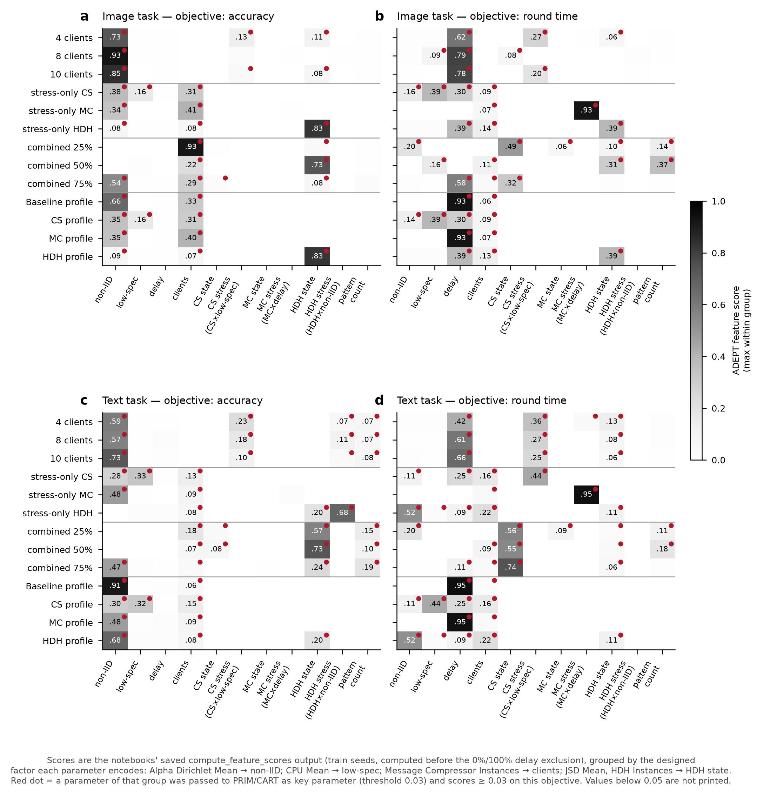
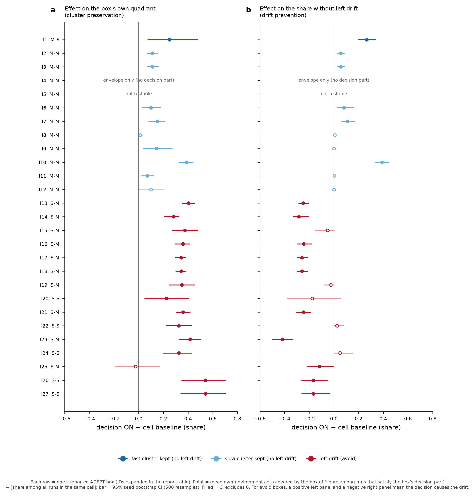
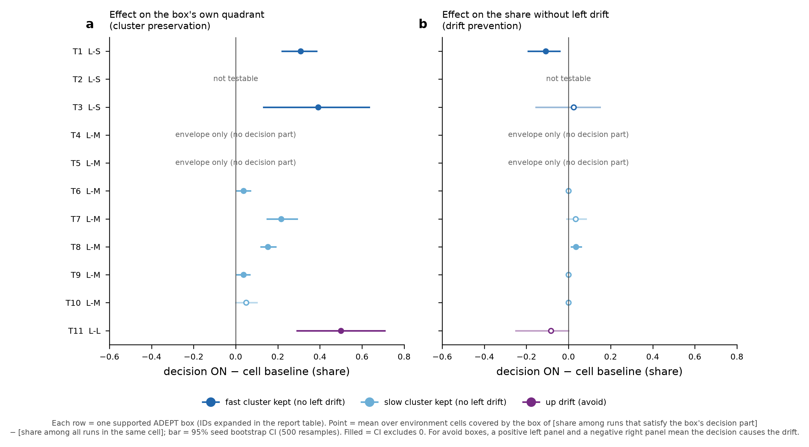

# Compact FL campaign — review 3: RQ2, rules that keep runs in their cluster and prevent left drift (for co-author discussion)

*Status: preliminary. This report follows review 1 (`review_preliminary_results.md` (first review bundle), revision 2) and review 2 (`review2_rq1_focus.md` (review 2 bundle)). It reuses the ADEPT feature analyses and boxes already computed in the 26 notebooks; nothing in ADEPT was re-executed. All runs at 0% and 100% delayed clients are excluded (870 runs per task).*

## 1. Goal and how RQ1 shaped the RQ2 setup

### 1.1 RQ2 as posed for this review
**RQ2** asks which constraints on pattern decisions (and, where unavoidable, on the environment) raise the share of runs in the target tradeoffs. After review 2 it was refined as follows (author's wording):
- "identify boxes (i.e., sets of constraints on decisions and environment variables) that prevent clusters from drifting to the left, or for the charts with 2 clear clusters the boxes enable us to preserve or ensure each of the clusters";
- "use the insights from review 2 to inform how we run feature importance and then select 'good boxes' from the whole set of boxes that is feasible to compute. Good boxes should give us the rules or restrictions (if any) for ensuring desirable quadrants";
- "for feature importance and boxes … rely on what's provided by ADEPT … reusing the feature analyses already coded in the notebooks, do not run them again."

### 1.2 RQ1 insights used to set up RQ2
1. **Proxies and aliases.** Several ADEPT parameters re-encode a designed factor:
   - `Alpha Dirichlet Mean` → non-IID share;
   - `CPU Mean` → low-spec share;
   - the three pattern "stress" percentages → a pattern state × its environment factor;
   - `JSD Mean` → HDH state; on image it also tracks the non-IID level (r = 0.74 among HDH-ON runs);
   - `Message Compressor Instances` → client count (number of clients using MC).

   Feature importance must therefore be read per *designed factor*, not per column.
2. **Two clusters on the time axis.** The fast cluster (< 8.25 s) contains only CS-ON runs. A run lands there when no delayed client is selected. The slow cluster is everything else.
3. **Left drift on image is environmental.** Non-IID ≥ 50% puts runs in S accuracy, and the client count moves the accuracy bands (4 clients ≈ 0.06–0.08 higher than 10).
4. **Per-pattern effects:**
   - CS is the only lever for speed;
   - MC has no matched effect (an `MC=ON` term means "exposed to the MC stress, i.e. delay");
   - HDH is "configured, not applied" on image;
   - on text HDH adds ≈ 2–3 s at high non-IID.
5. **Like-for-like evidence is needed.** Configurations were run at different environment points, so a box's precision can come from the environment it selects, not from the decision it names.
6. **0% / 100% delay excluded.** ADEPT's 24 "delay ≈ 0%" boxes no longer select any run (they are out of scope).

### 1.3 RQ2 goals mapped onto ADEPT's quadrant targets
ADEPT discovers one box per quadrant ("tradeoff"). The RQ2 goals are expressed with those quadrants:

| RQ2 goal | Image task (L accuracy never reached) | Text task |
|:---|:---|:---|
| Keep the **fast cluster** without left drift | M-S | L-S |
| Keep the **slow cluster** without left drift | M-M | L-M |
| **Left drift** (to avoid) | S-M, S-S | M-S, M-M |
| **Up drift** (to avoid) | — | L-L |

A box for a quadrant to keep yields a rule of the form "choose D within envelope E". A box for a drift quadrant yields "avoid D within envelope E".

### 1.4 Reading guide

- **Box** = an ADEPT PRIM or CART rule, rewritten in designed factors (review 1 §4.1).
- **Decision part (D)** = the box's restrictions on pattern states (CS / MC / HDH ON/OFF) and client count. In notebooks that fix the configuration (profiles, stress-only views), the fixed configuration is part of D ("fixed by notebook").
- **Envelope (E)** = the box's restrictions on the environment (low-spec / non-IID / delayed levels). The architect cannot choose E; it describes where the rule applies.
- **Like-for-like effect of D.** In every environment cell the box covers (same environment point and client count), compare two shares:
  - the share of runs that satisfy D;
  - the share among *all* runs of the campaign in that cell (every configuration that was run there).

  The cells are averaged with equal weight. The 95% interval comes from resampling the 10 seeds (500 resamples). Two outcomes are measured:
  - the box's **own quadrant**, which answers "does D keep / cause this cluster?";
  - the **no-left share**, i.e. accuracy stays M on image or L on text, which answers "does D prevent left drift?".
- **Driver** = the single term of D that alone produces the largest like-for-like effect (term ablation).

## 2. What was reused and what was added

| Step | Reused from ADEPT notebooks (saved outputs) | Added here (checks ADEPT does not provide) |
|:---|:---|:---|
| Feature importance | `compute_feature_scores` (train seeds), weighted ranking, key parameters (threshold 0.03) | Grouping of the 36 scored parameters into the designed factor each encodes |
| Boxes | 163 PRIM/CART boxes, their rules, held-out seeds | Re-scoring after the delay exclusion (review 1, rev. 2); canonical rules; decision / envelope split |
| Good-box selection | Held-out precision, coverage, lift, test score | Like-for-like test of D on two outcomes, term ablation, RQ1 mechanism flags |

**Selection funnel.**

| Stage | Image | Text |
|:---|---:|---:|
| ADEPT boxes in the 13 notebooks | 92 | 71 |
| Out of scope after excluding 0% / 100% delay | 12 | 12 |
| Distinct in-scope boxes (twins and PRIM/CART duplicates merged) | 49 | 38 |
| **Supported** on the held-out seeds (≥ 3 targets in box, precision ≥ 0.5, lift > 0.10) | 27 | 11 |
| … targeting a quadrant to keep (fast / slow) | 1 / 11 | 3 / 7 |
| … targeting a drift quadrant (left / up) | 15 / — | 0 / 1 |

All 24 out-of-scope boxes targeted the fast quadrants (image M-S, text L-S). This is why few fast-cluster boxes remain. Of the 8 image M-S boxes still in scope, 1 is supported. Of the 13 text left-drift boxes, none is supported.

## 3. Step 1 — ADEPT feature importance read through RQ1

**Goal of the chart.** It shows which designed factors ADEPT's feature analysis found influential in each notebook, once its 36 parameters are grouped by the factor they encode. It also shows which groups were handed to PRIM/CART as key parameters.

**How to read it.**
- Rows are the 13 notebooks of a task, grouped by family: client count, stress-only, combined, profiles. Columns are designed factors.
- A cell is the highest ADEPT score among the parameters of that group, for that objective (accuracy in the left panels, round time in the right panels).
- A red dot marks a group that ADEPT passed to discovery as a key parameter (score ≥ 0.03).
- The scores are the notebooks' saved outputs. They were computed before the 0% / 100% delay exclusion.

**Observations.**
- **Accuracy, image (a).**
  - Non-IID dominates in the client-count notebooks (0.73–0.93), in combined 75% (0.54) and in the baseline profile (0.66).
  - Where non-IID is fixed or confounded, its aliases take over:
    - "HDH state" scores 0.83 in the HDH views and 0.73 in combined 50%. This is `JSD Mean`, which tracks non-IID among HDH-ON runs (r = 0.74). RQ1 found no HDH effect on image accuracy.
    - "clients" scores 0.93 in combined 25% (one environment point, so only the client count is left to explain accuracy), and 0.31–0.41 in the CS, MC and Baseline views, partly through `Message Compressor Instances`.
  - CS terms reach at most 0.13.
- **Round time, image (b) and text (d).**
  - Delay has the highest round-time score in most notebooks (up to 0.93 on image and 0.95 on text). This reflects the pre-exclusion data, where 0% delay put every run in the fast bin.
  - The CS groups carry the rest: CS state 0.55–0.74 in the text combined notebooks; CS stress 0.20–0.44; low-spec 0.39–0.44 in the CS views.
  - In the stress-only MC view, MC stress scores 0.93–0.95; it is the delay share in disguise.
- **Accuracy, text (c).**
  - Non-IID dominates in the client-count, profile and combined 75% notebooks (0.47–0.91).
  - "HDH state" (0.57–0.73 in combined 25/50%) and HDH stress (0.68) carry partly real HDH information here: on text HDH costs −0.033 accuracy at high non-IID.
- **Implication for box selection.**
  - Once aliases are mapped, ADEPT's key parameters cover the factors RQ1 found relevant: non-IID, client count, CS and low-spec (and delay as the brake on CS).
  - The existing boxes can therefore be screened for RQ2 without re-running discovery.
  - Two readings must be applied to every box: proxy terms are translated back to designed factors, and the time-axis importance of delay is partly a 0%-delay artefact.

## 4. Step 2 — from boxes to rules

**Criterion for a good box** (review 1 §4.1, sharpened for RQ2):
1. **Held-out support:** supported grade after re-scoring.
2. **RQ2 relevance:** its target quadrant is one of the goals in §1.3.
3. **Quality:** ADEPT's test score (harmonic mean of normalized enrichment and coverage).
4. **Actionability:** a non-empty decision part D; envelope-only boxes are operating envelopes.
5. **Like-for-like confirmation of D**, on the relevant outcome:
   - *cluster preservation*: effect on its own quadrant > 0;
   - *drift prevention*: effect on the no-left share > 0 for a keep box, < 0 for a drift box (then the rule is "avoid D").
6. **Consistency with RQ1:** the driver term matches an RQ1 mechanism, the flags are read, and the rule recurs across notebooks.

**Goal of the charts.** For each supported box, they show whether the box's decision part itself changes the outcome when everything else is equal. They separate two questions: does D keep or cause the box's own quadrant (left panel)? Does D change the share of runs without left drift (right panel)?

**How to read them.**
- **Rows:** one supported box per row; the ID is expanded in the tables below.
- **Colors** give the RQ2 role: dark blue = fast cluster to keep, light blue = slow cluster to keep, red = left drift to avoid, purple = up drift to avoid.
- **Points and bars:** a point is the like-for-like effect (share with D − share of all runs in the same cells), and the bar is its 95% seed-bootstrap interval. A filled point means the interval excludes 0.
- **Keep boxes:** a filled point right of 0 in the left panel means D keeps the cluster; a filled point right of 0 in the right panel means D prevents left drift.
- **Drift boxes:** a filled point right of 0 in the left panel means D causes that drift quadrant; a filled point *left* of 0 in the right panel means D lowers the no-left share, so *avoiding* D prevents drift.

**Worked example (image, I13 vs I15).**
- **I13** (Baseline profile, S-M, `Baseline ∧ clients∈{8,10}` at non-IID 75%):
  - left panel: +40 pp, so the decision raises S-M;
  - right panel: −25 pp, so it also lowers the no-left share;
  - the ablation names `clients∈{8,10}` as the driver of the drift (−27 pp alone).
- **I15** (10 clients, S-M, `CS=OFF` at non-IID ≥ 50%):
  - left panel: +38 pp;
  - right panel: −5 pp, with an interval reaching 0.
  - `CS=OFF` only decides whether a left-drifted run is slow (S-M) or fast (S-S); it does not cause the drift.

### 4.1 Supported boxes — image task
| ID | Notebook / box | Target (role) | Decision part | Envelope | Held-out hits / targets | Precision vs prevalence | Test score | Effect on own quadrant, pp [95% CI] | Effect on no-left share, pp [95% CI] | Driver: own quadrant / no-left | RQ1 flags |
|:---|:---|:---|:---|:---|---:|:---|---:|:---|:---|:---|:---|
| I1 | combined 50% / PRIM Box 3 | M-S (fast kept) | `CS=ON ∧ MC=OFF ∧ clients∈{4}` | `low-spec%∈{50} ∧ delayed%∈{25}` | 4 / 5 | 0.67 vs 0.09 | 0.71 | +25 [+7, +48] | +27 [+20, +33] | clients∈{4} (25 pp) / clients∈{4} (27 pp) | train/test lift differ (+0.33 vs +0.57) |
| I2 | MC profile / PRIM Box 3 | M-M (slow kept) | `CS=OFF ∧ HDH=OFF ∧ MC=ON` *(fixed by notebook)* | `non-IID%∈{25}` | 36 / 38 | 1.00 vs 0.84 | 0.97 | +11 [+7, +15] | +6 [+3, +9] | CS=OFF (11 pp) / CS=OFF (6 pp) | MC=ON stands for delay exposure (no matched MC effect); CS=OFF selects away from the fast cluster; HDH on image is configured, not applied |
| I3 | Baseline profile / PRIM Box 3 | M-M (slow kept) | `CS=OFF ∧ HDH=OFF ∧ MC=OFF` *(fixed by notebook)* | `non-IID%∈{25}` | 18 / 23 | 1.00 vs 0.64 | 0.88 | +11 [+7, +16] | +6 [+3, +8] | CS=OFF (11 pp) / CS=OFF (6 pp) | CS=OFF selects away from the fast cluster; HDH on image is configured, not applied |
| I4 | 10 clients / PRIM Box 4 | M-M (slow kept) | `—` | `low-spec%∈{25,75} ∧ non-IID%∈{25}` | 36 / 47 | 1.00 vs 0.54 | 0.87 | envelope only | — | — | — |
| I5 | combined 50% / CART Box 1 | M-M (slow kept) | `MC=ON` | `delayed%∈{50}` | 18 / 34 | 1.00 vs 0.63 | 0.69 | not testable | — | — | MC=ON stands for delay exposure (no matched MC effect) |
| I6 | 8 clients / PRIM Box 4 | M-M (slow kept) | `CS=OFF` | `low-spec%∈{25,75} ∧ non-IID%∈{25}` | 24 / 47 | 1.00 vs 0.54 | 0.68 | +10 [+3, +18] | +8 [+3, +16] | single term / single term | CS=OFF selects away from the fast cluster |
| I7 | combined 75% / PRIM Box 4 | M-M (slow kept) | `CS=OFF ∧ HDH=OFF ∧ MC=ON` | `non-IID%∈{25} ∧ delayed%∈{75}` | 18 / 45 | 1.00 vs 0.42 | 0.57 | +15 [+8, +21] | +11 [+6, +17] | CS=OFF (15 pp) / CS=OFF (11 pp) | MC=ON stands for delay exposure (no matched MC effect); CS=OFF selects away from the fast cluster; HDH on image is configured, not applied |
| I8 | HDH profile / CART Box 2 | M-M (slow kept) | `CS=OFF ∧ HDH=ON ∧ MC=OFF` *(fixed by notebook)* | `low-spec%∈{25} ∧ non-IID%∈{25,50} ∧ delayed%∈{25}` | 8 / 20 | 1.00 vs 0.44 | 0.57 | +1 [+0, +3] | +1 [+0, +2] | CS=OFF (1 pp) / HDH=ON (-1 pp) | CS=OFF selects away from the fast cluster; HDH on image is configured, not applied |
| I9 | 4 clients / CART Box 1 | M-M (slow kept) | `CS=OFF ∧ HDH=OFF` | `low-spec%∈{25,75} ∧ non-IID%∈{25}` | 18 / 64 | 1.00 vs 0.74 | 0.44 | +14 [+4, +27] | +0 [+0, +0] | CS=OFF (13 pp) / HDH=OFF (0 pp) | CS=OFF selects away from the fast cluster; HDH on image is configured, not applied |
| I10 | combined 50% / PRIM Box 4 | M-M (slow kept) | `CS=OFF ∧ clients∈{4}` | `low-spec%∈{25}` | 9 / 34 | 1.00 vs 0.63 | 0.42 | +39 [+33, +44] | +39 [+33, +44] | clients∈{4} (39 pp) / clients∈{4} (39 pp) | CS=OFF selects away from the fast cluster |
| I11 | CS profile / PRIM Box 4 | M-M (slow kept) | `CS=ON ∧ HDH=OFF ∧ MC=OFF ∧ clients∈{8,10}` | `low-spec%∈{25} ∧ non-IID%∈{25} ∧ delayed%∈{25}` | 6 / 23 | 1.00 vs 0.51 | 0.41 | +7 [+2, +12] | +0 [+0, +1] | clients∈{8,10} (10 pp) / MC=OFF (-1 pp) | HDH on image is configured, not applied |
| I12 | 4 clients / PRIM Box 4 | M-M (slow kept) | `CS=OFF` | `low-spec%∈{25,75} ∧ non-IID%∈{25,50} ∧ delayed%∈{50,75}` | 13 / 64 | 1.00 vs 0.74 | 0.34 | +10 [+0, +20] | +0 [+0, +0] | single term / single term | CS=OFF selects away from the fast cluster |
| I13 | Baseline profile / PRIM Box 1 | S-M (left drift) | `CS=OFF ∧ HDH=OFF ∧ MC=OFF ∧ clients∈{8,10}` | `non-IID%∈{75}` | 12 / 13 | 1.00 vs 0.36 | 0.96 | +40 [+35, +45] | -25 [-28, -21] | CS=OFF (36 pp) / clients∈{8,10} (-27 pp) | HDH on image is configured, not applied |
| I14 | MC profile / PRIM Box 1 | S-M (left drift) | `CS=OFF ∧ HDH=OFF ∧ MC=ON ∧ clients∈{8,10}` | `low-spec%∈{25} ∧ non-IID%∈{75} ∧ delayed%∈{75}` | 6 / 7 | 1.00 vs 0.16 | 0.92 | +28 [+21, +32] | -28 [-32, -21] | clients∈{8,10} (27 pp) / clients∈{8,10} (-27 pp) | MC=ON stands for delay exposure (no matched MC effect); HDH on image is configured, not applied |
| I15 | 10 clients / PRIM Box 2 | S-M (left drift) | `CS=OFF` | `low-spec%∈{25,75} ∧ non-IID%∈{50,75}` | 27 / 33 | 1.00 vs 0.38 | 0.90 | +38 [+28, +48] | -5 [-15, +0] | single term / single term | — |
| I16 | combined 75% / CART Box 1 | S-M (left drift) | `CS=OFF ∧ clients∈{8,10}` | `non-IID%∈{75}` | 30 / 40 | 1.00 vs 0.37 | 0.86 | +36 [+29, +41] | -24 [-29, -18] | CS=OFF (36 pp) / clients∈{8,10} (-27 pp) | — |
| I17 | HDH profile / PRIM Box 2 | S-M (left drift) | `CS=OFF ∧ HDH=ON ∧ MC=OFF ∧ clients∈{8,10}` | `non-IID%∈{50,75}` | 19 / 25 | 0.95 vs 0.56 | 0.82 | +34 [+30, +38] | -26 [-30, -22] | CS=OFF (36 pp) / clients∈{8,10} (-28 pp) | HDH on image is configured, not applied |
| I18 | HDH profile / CART Box 1 | S-M (left drift) | `CS=OFF ∧ HDH=ON ∧ MC=OFF ∧ clients∈{8,10}` | `non-IID%∈{50,75}` | 19 / 25 | 0.95 vs 0.56 | 0.82 | +34 [+30, +38] | -26 [-30, -21] | CS=OFF (36 pp) / clients∈{8,10} (-28 pp) | HDH on image is configured, not applied |
| I19 | 8 clients / PRIM Box 2 | S-M (left drift) | `CS=OFF` | `low-spec%∈{25,75} ∧ non-IID%∈{75} ∧ delayed%∈{25,75}` | 21 / 31 | 1.00 vs 0.36 | 0.81 | +35 [+25, +45] | -2 [-8, +0] | single term / single term | — |
| I20 | 4 clients / PRIM Box 1 | S-S (left drift) | `CS=ON ∧ MC=OFF` | `low-spec%∈{75} ∧ non-IID%∈{75} ∧ delayed%∈{25}` | 4 / 4 | 0.67 vs 0.05 | 0.79 | +22 [+5, +40] | -17 [-37, +5] | CS=ON (22 pp) / CS=ON (-17 pp) | train/test lift differ (+0.39 vs +0.62) |
| I21 | combined 75% / PRIM Box 2 | S-M (left drift) | `CS=OFF ∧ HDH=ON ∧ clients∈{8,10}` | `non-IID%∈{75}` | 24 / 40 | 1.00 vs 0.37 | 0.75 | +36 [+31, +41] | -24 [-30, -19] | CS=OFF (36 pp) / clients∈{8,10} (-27 pp) | HDH on image is configured, not applied |
| I22 | 8 clients / PRIM Box 1 | S-S (left drift) | `CS=ON ∧ MC=OFF` | `low-spec%∈{75} ∧ non-IID%∈{75} ∧ delayed%∈{25}` | 4 / 6 | 0.67 vs 0.07 | 0.65 | +32 [+22, +42] | +2 [+0, +8] | CS=ON (32 pp) / CS=ON (2 pp) | — |
| I23 | combined 50% / PRIM Box 2 | S-M (left drift) | `CS=OFF ∧ HDH=ON ∧ clients∈{10}` | `low-spec%∈{25} ∧ non-IID%∈{50}` | 6 / 14 | 1.00 vs 0.26 | 0.60 | +42 [+33, +50] | -42 [-50, -33] | clients∈{10} (42 pp) / clients∈{10} (-42 pp) | HDH on image is configured, not applied |
| I24 | 10 clients / PRIM Box 1 | S-S (left drift) | `CS=ON ∧ MC=OFF` | `low-spec%∈{75} ∧ non-IID%∈{75} ∧ delayed%∈{25}` | 3 / 6 | 0.50 vs 0.07 | 0.48 | +32 [+20, +42] | +5 [+0, +15] | CS=ON (32 pp) / CS=ON (5 pp) | train/test lift differ (+0.65 vs +0.43) |
| I25 | CS profile / PRIM Box 2 | S-M (left drift) | `CS=ON ∧ HDH=OFF ∧ MC=OFF ∧ clients∈{8,10}` | `low-spec%∈{75} ∧ non-IID%∈{75} ∧ delayed%∈{25}` | 3 / 6 | 0.50 vs 0.13 | 0.46 | -2 [-19, +17] | -12 [-22, -0] | CS=ON (-36 pp) / clients∈{8,10} (-10 pp) | HDH on image is configured, not applied |
| I26 | combined 75% / PRIM Box 1 | S-S (left drift) | `CS=ON ∧ HDH=ON ∧ MC=OFF ∧ clients∈{8,10}` | `low-spec%∈{75} ∧ non-IID%∈{75} ∧ delayed%∈{25}` | 4 / 14 | 1.00 vs 0.13 | 0.44 | +54 [+35, +70] | -17 [-27, -5] | CS=ON (32 pp) / clients∈{8,10} (-12 pp) | HDH on image is configured, not applied |
| I27 | combined 75% / CART Box 3 | S-S (left drift) | `CS=ON ∧ HDH=ON ∧ MC=OFF ∧ clients∈{8,10}` | `low-spec%∈{75} ∧ non-IID%∈{75} ∧ delayed%∈{25}` | 4 / 14 | 1.00 vs 0.13 | 0.44 | +54 [+34, +70] | -17 [-26, -3] | CS=ON (32 pp) / clients∈{8,10} (-12 pp) | HDH on image is configured, not applied |

### 4.2 Supported boxes — text task
| ID | Notebook / box | Target (role) | Decision part | Envelope | Held-out hits / targets | Precision vs prevalence | Test score | Effect on own quadrant, pp [95% CI] | Effect on no-left share, pp [95% CI] | Driver: own quadrant / no-left | RQ1 flags |
|:---|:---|:---|:---|:---|---:|:---|---:|:---|:---|:---|:---|
| T1 | combined 75% / PRIM Box 3 | L-S (fast kept) | `CS=ON ∧ MC=OFF` | `low-spec%∈{75} ∧ delayed%∈{25}` | 13 / 23 | 0.72 vs 0.21 | 0.60 | +31 [+22, +38] | -11 [-19, -4] | CS=ON (31 pp) / CS=ON (-11 pp) | — |
| T2 | CS profile / PRIM Box 2 | L-S (fast kept) | `CS=ON ∧ HDH=OFF ∧ MC=OFF` *(fixed by notebook)* | `low-spec%∈{75} ∧ non-IID%∈{25} ∧ delayed%∈{25}` | 7 / 20 | 0.78 vs 0.44 | 0.44 | not testable | — | — | — |
| T3 | stress-only CS / CART Box 2 | L-S (fast kept) | `CS=ON ∧ HDH=OFF ∧ MC=OFF ∧ clients∈{8}` | `low-spec%∈{75} ∧ non-IID%∈{75} ∧ delayed%∈{25}` | 3 / 20 | 1.00 vs 0.44 | 0.26 | +39 [+13, +63] | +3 [-15, +15] | CS=ON (22 pp) / CS=ON (-12 pp) | train/test lift differ (+0.11 vs +0.56) |
| T4 | 10 clients / PRIM Box 4 | L-M (slow kept) | `—` | `low-spec%∈{25,75}` | 63 / 77 | 1.00 vs 0.89 | 0.90 | envelope only | — | — | — |
| T5 | 8 clients / PRIM Box 4 | L-M (slow kept) | `—` | `low-spec%∈{25,75}` | 63 / 77 | 1.00 vs 0.89 | 0.90 | envelope only | — | — | — |
| T6 | combined 50% / CART Box 1 | L-M (slow kept) | `clients∈{8,10}` | `—` | 27 / 47 | 1.00 vs 0.87 | 0.73 | +4 [+1, +7] | +0 [-1, +1] | single term / single term | — |
| T7 | 4 clients / PRIM Box 4 | L-M (slow kept) | `CS=OFF` | `low-spec%∈{25,75}` | 36 / 64 | 1.00 vs 0.74 | 0.72 | +22 [+15, +29] | +3 [-1, +8] | single term / single term | CS=OFF selects away from the fast cluster |
| T8 | combined 75% / PRIM Box 4 | L-M (slow kept) | `CS=OFF ∧ clients∈{8,10}` | `—` | 42 / 76 | 1.00 vs 0.70 | 0.71 | +15 [+12, +19] | +3 [+1, +6] | CS=OFF (25 pp) / CS=OFF (6 pp) | CS=OFF selects away from the fast cluster |
| T9 | combined 50% / PRIM Box 4 | L-M (slow kept) | `clients∈{8,10}` | `—` | 22 / 47 | 1.00 vs 0.87 | 0.64 | +4 [+1, +7] | +0 [-1, +1] | single term / single term | — |
| T10 | CS profile / PRIM Box 3 | L-M (slow kept) | `CS=ON ∧ HDH=OFF ∧ MC=OFF ∧ clients∈{8,10}` | `low-spec%∈{25} ∧ non-IID%∈{25} ∧ delayed%∈{25}` | 6 / 24 | 1.00 vs 0.53 | 0.40 | +5 [+0, +10] | +0 [+0, +0] | clients∈{8,10} (10 pp) / clients∈{8,10} (0 pp) | — |
| T11 | combined 75% / PRIM Box 5 | L-L (up drift) | `CS=OFF ∧ HDH=ON ∧ clients∈{4}` | `low-spec%∈{25} ∧ non-IID%∈{75} ∧ delayed%∈{75}` | 3 / 5 | 0.50 vs 0.05 | 0.53 | +50 [+29, +71] | -8 [-25, +0] | clients∈{4} (40 pp) / clients∈{4} (-7 pp) | — |

## 5. Results — image task

**R-I1. Prevent left drift: keep 4 clients when non-IID ≥ 50% (avoid 8 or 10 clients).** *Strong.*
- **Evidence:** seven drift boxes from five notebooks (Baseline, MC and HDH profiles; combined 50% and 75%): I13, I14, I16, I17/I18 (PRIM/CART pair), I21, I23.
  - Held-out precision 0.95–1.00 for S-M; test scores 0.60–0.96.
  - The decision part lowers the no-left share by 24–42 pp (all intervals below 0).
  - The ablation names `clients∈{8,10}` as the driver every time (−27 to −42 pp alone).
- **Mirror keep box:** I10 (`CS=OFF ∧ clients∈{4}`, combined 50%) raises the no-left share by +39 pp [+33, +44], driven by `clients∈{4}`.
- **Consistency:**
  - this matches RQ1 (4 clients shift the accuracy bands up by 0.06–0.08) and review 1's constraint check (`clients=4`: +46 pp acceptable at 75% non-IID);
  - the `CS=OFF` terms in these boxes only select the slow variant (S-M rather than S-S); they are not part of the rule.

**R-I2. CS at 75% low-spec and 75% non-IID does not rescue accuracy; it moves drifted runs into S-S.** *Moderate.*
- **Evidence:** I20, I22, I24 (4 / 8 / 10 clients) and I26/I27 (combined 75%).
  - `CS=ON ∧ MC=OFF` at 75/75/25 raises S-S by 22–54 pp; driver `CS=ON`.
  - The no-left effect is −17 pp [−37, +5] at 4 clients and +2 / +5 pp at 8 / 10 clients (none clearly different from 0). The −17 pp in combined 75% is driven by `clients∈{8,10}`.
- **Reading:** there, the left drift comes from the environment; CS only makes the drifted runs fast. The rule is "within 75/75/25, CS does not prevent drift", not "CS causes drift".
- **Gap:** RQ1's like-for-like CS drift at 75/25/75 (+22 pp S accuracy) has no supported ADEPT box (§7).

**R-I3. Keep the fast cluster (M-S): CS=ON ∧ MC=OFF with 4 clients, within low-spec 50% and delay 25%.** *Tentative.*
- **Evidence:** a single box, I1 (combined 50%): 4 / 5 held-out targets, precision 0.67 vs prevalence 0.09.
- **Like-for-like:** +25 pp M-S [+7, +48] and +27 pp no-left [+20, +33]. At 50/25/25 only CS was run, so the testable contrast is the client count (4 vs 8/10 clients with CS ON).
- **Caveat:** train and test lift differ (+0.33 vs +0.57).
- **Reading:** the box is consistent with the RQ1 mechanism. With 4 clients CS keeps 1–2 clients, which raises the chance that no delayed client is selected, and it keeps accuracy in M.

**R-I4. Keep the slow cluster (M-M): non-IID 25% is the operating envelope; `CS=OFF` keeps runs in M-M only by not entering M-S.** *Strong envelope, trivial decision.*
- **Envelope:** non-IID 25% boxes have the highest test scores of the task (I2–I4: 0.87–0.97, precision 1.00).
- **Decision:**
  - their decision parts (`CS=OFF`, plus a fixed configuration) raise M-M by 10–15 pp (I2, I3, I6, I7, I9), because without CS a run cannot be fast;
  - the no-left gain is small (0 to +11 pp);
  - `MC=ON` terms (I2, I5, I7) stand for delay exposure, not for an MC effect.

## 6. Results — text task

**R-T1. Keep the fast cluster (L-S): CS=ON ∧ MC=OFF within low-spec 75% and delay 25%.** *Moderate–strong.*
- **Evidence:**
  - T1 (combined 75%): 13 / 23 held-out targets, precision 0.72 vs prevalence 0.21, test score 0.60. Like-for-like +31 pp L-S [+22, +38]; driver `CS=ON`.
  - T3 (stress-only CS, 8 clients, 75/75/25) agrees: +39 pp [+13, +63], from only 3 held-out targets.
  - T2 (CS profile, 75/25/25) agrees but is not testable, because only CS was run at that point.
- **Cost:** −11 pp no-left [−19, −4]. With few clients CS loses some accuracy below L (RQ1: −0.045 to −0.052).
- **On `MC=OFF`:** the ablation shows it is not the driver; MC adds ≈ 0.4 s per round (RQ1).

**R-T2. Keep the slow cluster (L-M): an operating envelope plus `CS=OFF`.** *Strong envelope, trivial decision.*
- **Envelope:** the best boxes are envelope-only: low-spec ∈ {25, 75}% (T4, T5: 63 / 77, test score 0.90).
  - This is a design artefact: in the client-count notebooks, the 50%-low-spec points (50/25/25, 50/25/50, 50/50/25) were run only with CS-containing configurations, which reach L-S often.
- **Decision:**
  - `CS=OFF` keeps runs in L-M (+15 to +22 pp, T7, T8) by giving up L-S;
  - `clients∈{8,10}` adds +4 pp (T6, T9);
  - none changes the no-left share (text runs rarely drift left).

**R-T3. Prevent up drift (L-L): avoid HDH without CS at 4 clients when non-IID and delay are both 75%.** *Tentative.*
- **Evidence:** T11 (combined 75%): 3 / 5 held-out targets.
  - Like-for-like +50 pp L-L [+29, +71]; driver `clients∈{4}` (+40 pp alone).
- **Consistency:** RQ1 found HDH adds ≈ +3 s at 25/75/75 and has its largest time spread at 4 clients.

**R-T4. Prevent left drift on text: no rule from ADEPT.**
- None of the 13 text left-drift boxes is supported; they are weak or unvalidatable, because left drift affects only a few percent of text runs.
- RQ1 found the drift where CS and HDH meet at 75/75/25 (interaction +17 pp); no ADEPT box captures it.

## 7. Summary — rules for ensuring desirable quadrants

| Task | Goal | Rule (decision part) | Envelope (where it holds) | Evidence | Strength |
|:---|:---|:---|:---|:---|:---|
| Image | Prevent left drift | Use 4 clients; avoid 8 / 10 | non-IID ≥ 50% | 7 drift boxes + 1 keep box; no-left −24 to −42 pp for 8 / 10 clients, +39 pp for 4 | Strong |
| Image | Prevent left drift | CS does not help (only turns S-M into S-S) | 75/75/25 | 5 S-S boxes; no-left effect not different from 0 | Moderate |
| Image | Keep fast cluster (M-S) | CS=ON ∧ MC=OFF ∧ 4 clients | low-spec 50%, delay 25% | 1 box, 4 / 5 held-out; +25 pp M-S | Tentative |
| Image | Keep slow cluster (M-M) | none needed beyond CS=OFF | non-IID 25% | envelope boxes, test score 0.87–0.97 | Strong envelope |
| Text | Keep fast cluster (L-S) | CS=ON ∧ MC=OFF | low-spec 75%, delay 25% | 2 testable boxes; +31 / +39 pp L-S; costs −11 pp no-left | Moderate–strong |
| Text | Keep slow cluster (L-M) | none needed beyond CS=OFF | low-spec 25% or 75% | envelope boxes, test score 0.90 | Strong envelope |
| Text | Prevent up drift (L-L) | Avoid HDH without CS at 4 clients | non-IID 75%, delay 75% | 1 box, 3 / 5 held-out; +50 pp L-L | Tentative |
| Text | Prevent left drift | — (no supported box) | — | — | Gap |

**In short.**
- **Image:** the decisive lever against left drift is the client count, not a pattern. CS moves runs down (faster) but does not protect accuracy.
- **Text:** CS is the lever that creates the fast cluster, at a small accuracy cost. The slow cluster is kept by simply not using CS. HDH at 4 clients under high non-IID and delay is the one combination to avoid.

## 8. Gaps between RQ1 and the ADEPT boxes

| RQ1 finding (review 2) | Matching supported ADEPT box? | Why missing |
|:---|:---|:---|
| CS causes left drift at 75/25/75 (image, +22 pp) | No | The only box covering CS runs at 75/25/75 for a drift quadrant (CS profile CART Box 2, S-M, and its stress-only twin) is weak |
| CS × HDH causes left drift at 75/75/25 (text, +17 pp interaction) | No | Text left-drift boxes are weak or unvalidatable (rare target) |
| Delay share brakes the fast cluster (CS at 75/25/75: 10% fast vs 63% at 75/25/25) | Indirect only (envelopes contain delay 25%) | Discovery ran before the exclusion; fast boxes were "delay ≈ 0%" and are out of scope |
| Fast-cluster mechanism (no delayed client selected) | No | Not a designed variable (choice made in review 2 to keep boxes prescriptive) |

## 9. Caveats and open questions

- **No re-execution.** Feature scores and boxes come from the notebooks' saved outputs, which were computed on the full data before the delay exclusion. Boxes were re-scored on the filtered data, but discovery was not repeated. A re-run on the filtered data, with RQ2-specific targets (for example "no left drift" or "fast cluster without left drift" as single targets), would likely find the missing rules of §8. Should we do this as a next step?
- **Membership reproduction.** The original box rules were re-applied to the data: 135 of 139 in-scope boxes reproduce exactly. Two HDH-image boxes and their twins differ by one run, at a rounded `JSD Mean` threshold.
- **Like-for-like cells** use every configuration the campaign ran at the same environment point and client count. Where only one configuration was run (e.g. CS at 50/25/25 or 75/25/25), the decision cannot be tested (I5, T2).
- **Small boxes.** Several rules rest on 3–5 held-out targets (I1, T3, T11) and some show train/test lift differences. They are flagged as tentative.
- **Client count as a lever.** R-I1 assumes the architect can choose the number of participating clients. Is that the case in the target scenario (open question from review 1)?
- **HDH on image** is "configured, not applied"; rules naming HDH on image should be read as rules about the non-IID exposure of HDH configurations.

## 10. Supporting files

- Figures: [rq2_feature_groups.png](figures/rq2_feature_groups.png), [rq2_box_effects_image.png](figures/rq2_box_effects_image.png), [rq2_box_effects_text.png](figures/rq2_box_effects_text.png), [review2_reading_guide.png](figures/review2_reading_guide.png)
- Tables: [rq2_good_box_candidates.csv](tables/rq2_good_box_candidates.csv) (all 38 supported boxes with metrics, like-for-like effects and flags), [rq2_feature_groups.csv](tables/rq2_feature_groups.csv) (grouped ADEPT scores), [rq2_boxes_canonical_image.csv](tables/rq2_boxes_canonical_image.csv), [rq2_boxes_canonical_text.csv](tables/rq2_boxes_canonical_text.csv) (all re-scored boxes, from review 1)
- Earlier reviews: `review_preliminary_results.md` (first review bundle), `review2_rq1_focus.md` (review 2 bundle)
