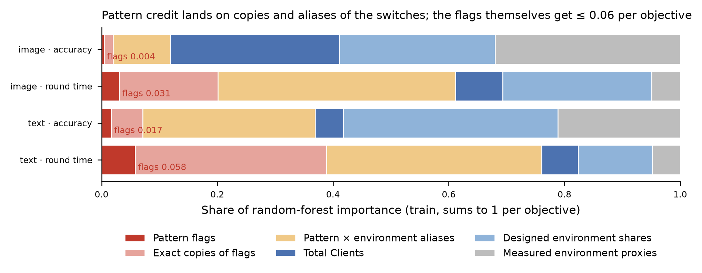
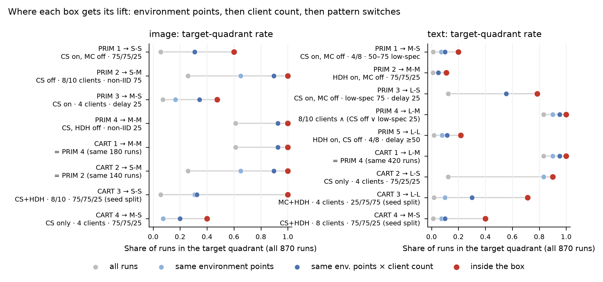
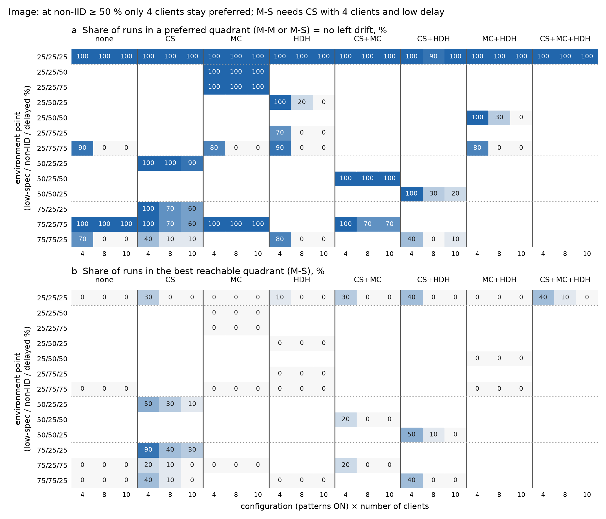
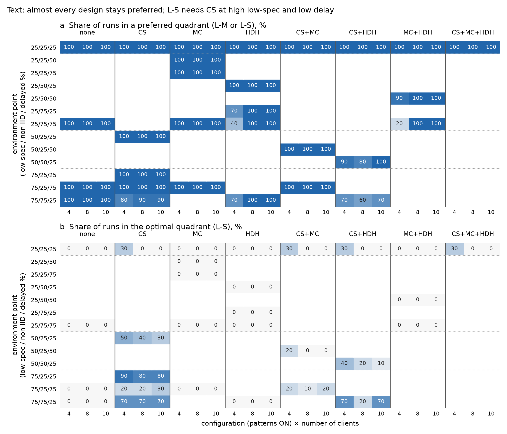
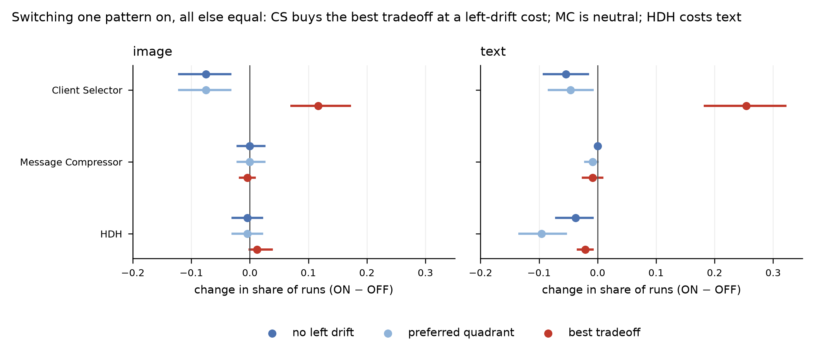
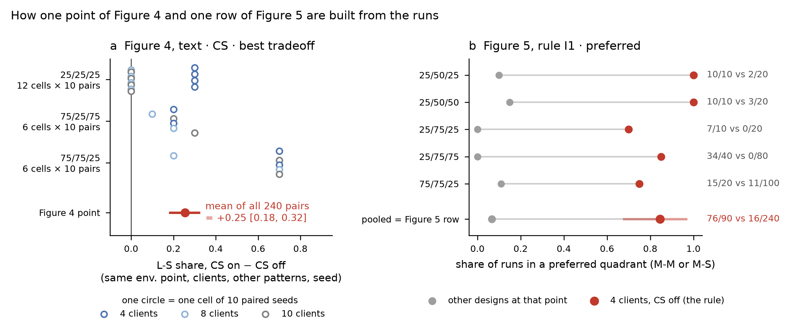
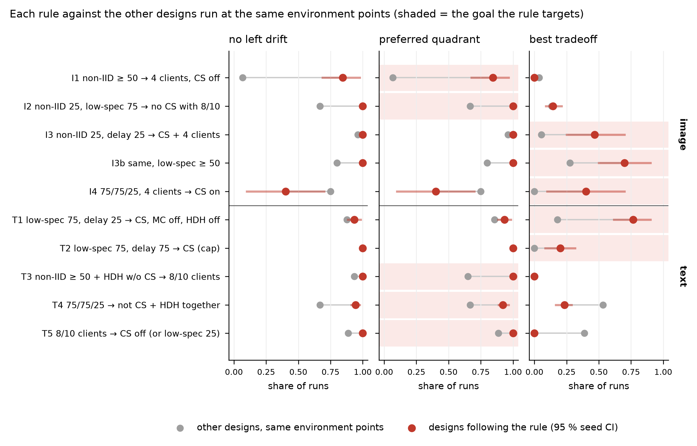

# Review 4 — RQ2 on the full-design notebooks: rules an architect can use to stay in a target region

*Status: preliminary, revision 3. Revision 3 explains how Figures 4 and 5 are computed (§5.1, §6.1, new Figure 6) and restricts the like-for-like alternatives to environment points shared with the rule; only I1 and T5 change, slightly. Revision 2 reorganised the analysis around three architect goals: no left drift, a preferred tradeoff, and the best tradeoff. It turns the ADEPT boxes into IF-environment / THEN-design rules and adds a goal / how-to-read / worked example / observations block for every chart. Source notebooks: `image/analysis-fl-rq-full-design-image.ipynb` and `text/analysis-fl-rq-full-design-text.ipynb`, with the boxes from `image|text/boxes/analysis-fl-rq-full-design-*.md`.*

## 1. Goals, levers and how the rules are built

### 1.1 What the architect controls and what is given
- **Levers (design choices):** Client Selector (CS), Message Compressor (MC) and Heterogeneous Data Handler (HDH), each ON or OFF, and the number of clients (4 / 8 / 10). Client count is treated as a lever here; whether it really is one is an open question for the authors.
- **Environment (given, not controlled):** the shares of low-spec, non-IID and delayed clients, written as an environment point *low-spec / non-IID / delayed %* (e.g. 75/75/25).
- The fixed training settings (20 rounds, Adam, learning rate 0.001, batch 64, 1 epoch) and the pattern settings (CS keeps CPU ≥ 2, zlib, DCGAN) have one value in the campaign. No rule can say anything about them.

### 1.2 The three goals
| Goal | Image (CIFAR-10 + CNN) | Text (AG_NEWS + MLP) |
|:---|:---|:---|
| **No left drift** | accuracy stays M (≥ 0.477); S-S and S-M are left drift | accuracy stays L (≥ 0.747); M-S and M-M are left drift |
| **Preferred tradeoff** | M-M or M-S (identical to *no left drift*, because image never reaches L accuracy or L time) | L-M or L-S, i.e. no left drift **and** no upward drift to L-L |
| **Best tradeoff** | M-S, the best reachable quadrant (L-S never occurs on image) | L-S, the optimal quadrant |

### 1.3 How a rule is written and checked
- **Form:** *IF the environment is …, THEN choose these patterns and this client count*. The IF part is the operating envelope; the THEN part is the design.
- **Score:** the share of runs following the rule that reach the goal, with a 95 % seed-cluster bootstrap CI (10 seeds, 1,000 resamples). The rule is applied to all 870 runs; the held-out test partition (261 runs) is reported separately.
- **Like-for-like reference:** the *other designs run at the same environment points*, restricted to points where the rule's own design was also run. A rule is useful only if it beats them, because then the gain comes from the design and not from the environment.
- **Campaign caveat:** the design is not crossed. All 8 configurations were run at 25/25/25 only. The points 75/25/75 (CS × MC), 75/75/25 (CS × HDH) and 25/75/75 (MC × HDH) contain a 2×2 of patterns, and every other point has a single configuration. Away from those four points, rules can compare client counts but not patterns.
- **Strength labels:**
  - *strong*: at least 60 runs and a CI of the difference against the alternatives that stays above +0.15;
  - *moderate*: a CI of the difference above 0;
  - *tentative*: fewer than 30 runs or a wide CI.

### 1.4 What was recomputed
No feature scoring or PRIM/CART was re-executed. The data were reloaded through the ADEPT loader with the notebooks' preprocessor and split. This reproduces the 609/261 split, and all 17 boxes reproduce the held-out counts in the box reports exactly. Everything below is recomputed from those runs.

## 2. What ADEPT reports: feature credit and the flags

**Goal of the chart.** It shows whether adding the three explicit flags (`CS Enabled`, `MC Enabled`, `HDH Enabled`) changed which variables ADEPT considers important, and why the flags never appear in a box.

**How to read it.**
- One bar per task and objective; the bar is the notebook's random-forest importance (cell 48, training runs), summing to 1.
- The 29 scored parameters are grouped into six families:
  - dark red: the flags;
  - light red: exact copies of the flags, i.e. pattern settings that are empty when OFF and constant when ON;
  - yellow: aliases mixing a pattern with an environment factor (stress %, instance counts, JSD Mean);
  - dark blue: client count;
  - light blue: the designed environment shares;
  - grey: measured environment proxies (CPU Mean, Alpha Dirichlet Mean).

**Worked example.** For image round time, the CS flag gets 0.026, its four exact copies (Strategy, Criteria, Value, Instances) together 0.147, and `Client Selector Stress Percentage` 0.278. All three describe the same switch; the alias also carries the low-spec share.

**Observations.**
- The flags receive only 0.004–0.058 of the credit per objective. Copies take 0.016–0.331, and pattern × environment aliases take 0.099–0.411.
- In this campaign `CS Enabled` splits the runs identically to 4 other columns, `MC Enabled` to 1 and `HDH Enabled` to 9. When columns tie, which one a box reports is arbitrary, so `Client Selector Strategy: {Resource-Based}` is the rule `CS Enabled = ON`. ADEPT's *Architectural interpretation* already translates these back.
- Of the 17 boxes:
  - 8 contain exactly the same runs as a box written with only the flags, client count and environment shares;
  - 7 narrow a designed cell with a measured, seed-level quantity (HDH instances, JSD Mean, CPU Mean), which is not a choice an architect can make;
  - 2 (text PRIM 4 = CART 1) use the CS stress alias to express an OR: *CS off, or low-spec 25 %*.
- **Conclusion:** keeping the flags is harmless and correct. They become the pattern variables as soon as the copies are excluded from discovery (§9).

## 3. The ADEPT boxes, read as architect statements

**Goal of the chart.** It shows where each box's precision comes from: the environment it selects, the client count, or the pattern switches. Only the last two are design choices.

**How to read it.**
- One row per box, labelled with the box id, its target quadrant and its translation into designed variables.
- Four points per row, all as the share of runs in the box's target quadrant:
  1. grey: all 870 runs of the task (the baseline prevalence);
  2. light blue: all runs at the box's environment points, whatever their design;
  3. dark blue: all runs at those environment points *and* with the box's client counts;
  4. red: the runs inside the box.
- The cells in points 2 and 3 are weighted by the box's own runs.
- Gaps between points:
  - grey → light blue is the environment;
  - light → dark blue is the client count;
  - dark blue → red is the pattern switches, or a measured-quantity cut.
- When light and dark blue coincide, the box spans every client count.

**Worked example (image PRIM 2 → S-M).** S-M is 26 % of all image runs. At the box's environment points (non-IID 75 %) it is 65 %; with 8/10 clients, 90 %; inside the box (CS off), 100 %. Most of the lift therefore comes from the environment and the client count. The CS-off condition adds the last 10 points, because CS sends some of these runs to S-S instead, which is just as left.

**How each box maps to a goal.** A box whose target is a preferred or best quadrant is a *keep-in* statement. A box whose target is a left (or L-L) quadrant is an *avoid* statement: its conditions are what the architect should steer away from.

| Task | Box | Target | Designed reading | Role | Precision: test hits / in box; all runs | Feeds rule |
|:---|:---|:---|:---|:---|:---|:---|
| Image | PRIM 2 = CART 2 | S-M | CS off · 8/10 clients · non-IID 75 % | avoid (left) | 42/42; 1.00 | I1 |
| Image | PRIM 1 | S-S | CS on, MC off · 75/75/25 | avoid (left) | 11/18; 0.60 | I1, I4 |
| Image | CART 3 | S-S | CS+HDH · 8/10 · 75/75/25 (JSD cut) | avoid (left) | 4/4; 1.00 | I1 |
| Image | PRIM 3 | M-S | CS on · 4 clients · delay 25 % | keep-in (best) | 9/26; 0.48 | I3, I3b |
| Image | CART 4 | M-S | CS only · 4 clients · 75/75/25 | keep-in (best) | 1/3; 0.40 | I4 |
| Image | PRIM 4 = CART 1 | M-M | CS off, HDH off · non-IID 25 % | keep-in (preferred) | 54/54; 1.00 | I2 (context) |
| Text | PRIM 3 | L-S | CS on, MC off · low-spec 75 · delay 25 (HDH-instance cut) | keep-in (best) | 15/19; 0.78 | T1 |
| Text | CART 2 | L-S | CS only · 4 clients · 75/25/25 | keep-in (best) | 3/3; 0.90 | T1 |
| Text | PRIM 4 = CART 1 | L-M | 8/10 clients ∧ (CS off ∨ low-spec 25 %) | keep-in (preferred) | 126/126; 1.00 | T5 |
| Text | PRIM 5 | L-L | HDH on, CS off · 4/8 clients · delay ≥ 50 % | avoid (up) | 5/18; 0.22 | T3 |
| Text | CART 3 | L-L | MC+HDH · 4 clients · 25/75/75 (JSD cut) | avoid (up) | 2/2; 0.71 | T3 |
| Text | PRIM 1 | M-S | CS on, MC off · 4/8 · 50/50/25, 75/75/25 | avoid (left) | 2/12; 0.20 | T4 |
| Text | PRIM 2 | M-M | HDH on, MC off · 75/75/25 | avoid (left) | 1/17; 0.11 | T4 |
| Text | CART 4 | M-S | CS+HDH · 8 clients · 75/75/25 (seed cut) | avoid (left) | 0/2; 0.40 | T4 |

Full translation with the original conditions: [rq2fd_box_translation.csv](data/rq2fd_box_translation.csv); per-cell membership: [rq2fd_box_cells.csv](data/rq2fd_box_cells.csv).

**Observations.**
- **Image:** the dominant boxes are environmental. Non-IID 75 % with 8/10 clients is left in 90–100 % of runs (100 % without CS), and non-IID 25 % without CS and HDH is always M-M. The pattern-driven boxes are the CS boxes, both fast: S-S when the environment pushes left, M-S when it does not.
- **Text:** the L-S boxes are pattern-driven. CS at high low-spec and low delay adds +0.23 over the other designs at the same points. The L-M box is a client-count rule, and the L-L and left boxes rest on few examples (12 L-L and 8 + 8 M-S/M-M training targets).

## 4. Where each goal is reached: the design maps

**Goal of the chart.** It shows, for every design that was actually run, how often it reaches the preferred quadrants (panel a) and the best quadrant (panel b) at each environment point. The boxes summarise this map, and it lets you check any rule cell by cell.

**How to read it.**
- **Rows** are environment points (low-spec / non-IID / delayed %). Dotted lines group them by low-spec share (25 / 50 / 75 %); 25/25/25 is the top row.
- **Column groups** are configurations: the patterns switched ON ("none" is the baseline). Within a group, the three columns are 4, 8 and 10 clients.
- **Each cell** holds 10 runs (seeds); the number is the percentage reaching the goal, and darker blue means higher.
- **White cells without a number** were not run. Comparisons are only like-for-like within a row.

**Worked example (Figure 3a, row 25/75/75).** At 25 % low-spec, 75 % non-IID and 75 % delayed, the baseline stays preferred in 90 % of runs with 4 clients but 0 % with 8 or 10. MC, HDH and MC+HDH behave the same way (80–90 % vs 0 %). No pattern fixes the drift there; only the client count does.

**Observations.**
- **Image, preferred (panel a):**
  - Every row with non-IID ≥ 50 % keeps runs preferred only with 4 clients.
  - With 8/10 clients, CS at low-spec 75 % costs 30–40 points even at non-IID 25 % (75/25/25 and 75/25/75: 60–70 %).
- **Image, best (panel b):**
  - M-S needs CS and is much more frequent with 4 clients.
  - It peaks at 75/25/25 (90 %) and falls with delay (75/25/75: 20 %) and with non-IID (75/75/25: 40 %).
- **Text, preferred (panel a):**
  - Nearly everything stays preferred.
  - The exceptions are HDH without CS at 4 clients when non-IID is high (25/75/75: 20–40 %; 25/75/25 and 75/75/25: 70 %), CS at 75/75/25 (80–90 %), and CS combined with HDH at 75/75/25 (60–70 %).
- **Text, best (panel b):**
  - L-S needs CS and rises with the low-spec share: 30 % at 25 % (4 clients only), 30–50 % for CS alone at 50/25/25, 70–90 % at 75 % with delay 25 %.
  - Delay 75 % caps it at 10–30 %.

## 5. What each pattern does on its own

**Goal of the chart.** It isolates each pattern's own effect on the three goals, to show which patterns can be combined freely and which carry a cost. It answers: *if I switch this one pattern on and change nothing else, how much more (or less) often do runs reach the goal?*

### 5.1 How Figure 4 is computed

*Figure 6. Panel a unpacks one point of Figure 4; panel b unpacks one row of Figure 5 (see §6.1).*

Each point of Figure 4 is built in four steps:
1. **Find twin runs.** Take every run with the pattern ON and look for its twin with the pattern OFF: same environment point, same client count, same seed, and the same state of the other two patterns. Twins exist only where the campaign ran both states, which for CS means 25/25/25, 75/25/75 and 75/75/25. There are 240 twin pairs per pattern.
2. **Score each twin.** For each run, record 1 if it reaches the goal and 0 otherwise. The difference ON − OFF of a pair is +1, 0 or −1.
3. **Average.** The point is the mean of the 240 differences. Because every *cell* (environment point × client count × other patterns) holds exactly 10 pairs, this equals the mean of the cell-level differences. Each circle in Figure 6a is one cell.
4. **Confidence interval.** Resample the 10 seeds with replacement 1,000 times, recompute the mean each time, and take the 2.5th and 97.5th percentiles. The interval reflects seed-to-seed variation only.

**Worked example (Figure 6a: text, CS, best tradeoff).**
- At 25/25/25, CS raises L-S from 0 to 30 % with 4 clients and has no effect with 8/10 clients. This holds for every combination of MC and HDH (12 cells).
- At 75/25/75 it raises L-S by 10–30 points (6 cells).
- At 75/75/25 it raises L-S by 70 points, except CS+HDH at 8 clients (20 points).
- The mean over all 24 cells is +0.25 [+0.18, +0.32], the red point in Figure 4.

### 5.2 How to read and interpret Figure 4
- Each point is the change in the share of runs reaching a goal when one pattern is switched from OFF to ON, with a 95 % seed CI. Right of zero means the pattern helps that goal.
- Colours: dark blue = no left drift, light blue = preferred, red = best. On image, no left drift and preferred coincide.
- **It is an average over the twin cells.** Figure 6a shows how much it hides: the CS effect on text L-S ranges from 0 to +0.70 depending on the environment point and the client count. Use Figure 4 to know *which patterns move which goal, and in which direction*. Use the design maps (Figure 3) or the rules (§6) to know *where*.
- **What it is not.** It is not an effect at environment points where the twin was not run (e.g. 50/25/25 or 75/25/25), and it is not a prediction for other client counts or tasks.

**Observations.**
- **Message Compressor** changes none of the goals on either task (all effects within ±0.01). It can be combined with anything; it is neutral for these goals.
- **Client Selector** is the only pattern that moves runs towards the best tradeoff: image +0.12 [+0.07, +0.17], text +0.25 [+0.18, +0.32]. It costs some left drift: image -0.07 [-0.12, -0.03]; text no-left -0.05 [-0.09, -0.02], preferred -0.05 [-0.08, -0.01].
- **HDH** is neutral on image: it runs but almost never does work there. On text it costs -0.10 [-0.13, -0.05] preferred, through L-L at 4 clients and left drift together with CS.

## 6. The rulebook

**Goal of the chart.** It shows, for each rule, how much better than the alternatives the architect does by following it, and what it costs on the other two goals. It answers: *in this environment, how often does this recipe land in my goal, compared with the other designs that were tried in the same environment?*

### 6.1 How Figure 5 is computed

Each row of Figure 5 is built in five steps (Figure 6b unpacks rule I1):
1. **Select the environment.** Take every run whose environment point satisfies the IF part. For I1 (non-IID ≥ 50 %) these are the points 25/50/25, 25/50/50, 25/75/25, 25/75/75, 50/50/25 and 75/75/25.
2. **Split by design.** Runs whose design satisfies the THEN part follow the rule (I1: 4 clients and CS off). All other runs at the same points are the alternatives.
3. **Keep only shared points.** Alternatives are kept only at environment points where the rule's design was also run, so both groups face the same environments. For I1 this drops 50/50/25, where only CS+HDH was run.
4. **Score.** The red point is the share of rule runs reaching the goal (I1: 76 of 90 runs preferred = 0.84). The grey point is the same share among the alternatives (I1: 16 of 240 = 0.07). This is done for all three goals, so one row shows the target goal and the two side effects.
5. **Confidence interval.** Seeds are resampled as in §5.1. The table below also gives the CI of the difference, red − grey.

**Worked example (Figure 6b: rule I1, preferred).** At every non-IID ≥ 50 % point, 4 clients without CS stay preferred in 70–100 % of runs (7/10 to 10/10, and 34/40 at 25/75/75). The other designs at those points stay preferred in 0–15 % of runs; they are mostly 8/10-client runs, or CS runs at 75/75/25. Pooled, this gives 0.84 against 0.07, a difference of [+0.61, +0.91].

### 6.2 How to read and interpret Figure 5
- One row per rule (I = image, T = text), one column per goal. The pink band marks the goal the rule targets.
- A long grey-to-red segment pointing right means the rule helps that goal. A segment pointing left (grey right of red) is the price paid on that goal. For I4, for example, the red point is left of grey on *no left drift* and right of grey on *best*.
- **Difference from Figure 4.** Figure 4 changes one switch and holds everything else fixed. Figure 5 compares a full recipe (patterns + client count) with *whatever else the campaign ran* in the same environments, so the grey point depends on which alternatives exist. For I1 they are mostly 8/10-client runs. A rule's gap is therefore "how much better than what was tried", not an isolated effect of one switch. Read the two figures together: Figure 4 says which switch matters; Figure 5 says whether a concrete recipe reaches the goal.
- **What it is not.** It is not a guarantee: the CI reflects seed variation within this campaign only. A rule built on few runs (I3b, I4: 20 runs each) can change with more data.

### 6.3 Image rules

| Rule | IF (environment) | THEN (design) | Goal | Runs (test) | P(goal) [95 % CI] | Test | Other designs, same env. points | Difference [95 % CI] | Cost on other goals | Boxes | Strength |
|:---|:---|:---|:---|---:|:---|---:|---:|:---|:---|:---|:---|
| **I1** | non-IID ≥ 50 % | 4 clients, CS off (any MC/HDH) | preferred = no left | 90 (27) | 0.84 [0.68, 0.97] | 0.96 | 0.07 | [+0.61, +0.91] | no M-S (0 % vs 4 %) | PRIM 2, CART 2, PRIM 1, CART 3 | strong |
| **I2** | non-IID 25 % ∧ low-spec 75 % | CS off, or CS only with 4 clients | preferred = no left | 90 (27) | 1.00 [1.00, 1.00] | 1.00 | 0.67 | [+0.20, +0.48] | none (M-S 14 % vs 13 %) | none: gap filled from the map | strong |
| **I3** | non-IID 25 % ∧ delay 25 % | CS on, 4 clients | best (M-S) | 60 (18) | 0.47 [0.25, 0.70] | 0.28 | 0.05 | [+0.21, +0.65] | none: preferred stays 1.00 | PRIM 3 | moderate |
| **I3b** | as I3 and low-spec ≥ 50 % | CS on, 4 clients | best (M-S) | 20 (6) | 0.70 [0.50, 0.90] | 0.83 | 0.28 | [+0.20, +0.65] | none: preferred 1.00 | PRIM 3 | tentative |
| **I4** | 75/75/25, 4 clients | CS on | best (M-S) | 20 (6) | 0.40 [0.10, 0.70] | 0.33 | 0.00 | [+0.10, +0.70] | preferred 0.40 vs 0.75 with CS off | CART 4, PRIM 1 | tentative (trade) |

- **I1 — to avoid left drift with skewed data, use few clients and no CS.** The client count is the lever; the patterns are not (Figure 3a, rows with non-IID ≥ 50 %). PRIM 2/CART 2 is the avoid side (8/10 clients → S-M in 100 %). PRIM 1/CART 3 show that switching CS on does not rescue accuracy; it only makes the left runs fast (S-S).
- **I2 — with mostly IID data but many low-spec clients, do not run CS on a large federation.** CS with 8/10 clients at 75/25/25 and 75/25/75 drifts left in 30–40 % of runs, because it trains on the few high-spec clients. No ADEPT box captured this; the rule comes from the design map.
- **I3/I3b — to reach M-S, enable CS on a 4-client federation when delay is low.** The risk-free version is non-IID 25 %: preferred stays 100 % while M-S rises from 5 % to 47 %, and to 70 % when low-spec ≥ 50 % (90 % at 75/25/25). About 50 % is the ceiling when the environment is mixed, because a run is fast only if CS selects no delayed client.
- **I4 — with skewed data and many low-spec clients, M-S and no-left conflict.** CS with 4 clients at 75/75/25 gives 40 % M-S but also 60 % left (S-S/S-M). CS off gives 0 % M-S and 75 % preferred. This is a genuine tradeoff the architect must choose.

### 6.4 Text rules

| Rule | IF (environment) | THEN (design) | Goal | Runs (test) | P(goal) [95 % CI] | Test | Other designs, same env. points | Difference [95 % CI] | Cost on other goals | Boxes | Strength |
|:---|:---|:---|:---|---:|:---|---:|---:|:---|:---|:---|:---|
| **T1** | low-spec 75 % ∧ delay 25 % | CS on, MC off, HDH off (any clients) | best (L-S) | 60 (18) | 0.77 [0.62, 0.90] | 0.78 | 0.18 | [+0.47, +0.69] | preferred 0.93 vs 0.86 (gain) | PRIM 3, CART 2 | strong |
| **T2** | low-spec 75 % ∧ delay 75 % | CS on | best (L-S) | 60 (18) | 0.20 [0.08, 0.32] | 0.17 | 0.00 | [+0.08, +0.32] | none | none: limit from the map | strong (limit) |
| **T3** | non-IID ≥ 50 % and HDH on without CS | 8/10 clients | preferred | 120 (36) | 1.00 [1.00, 1.00] | 1.00 | 0.65 | [+0.20, +0.53] | none (no L-S either way) | PRIM 5, CART 3 | strong |
| **T4** | 75/75/25 | do not combine CS with HDH | preferred | 90 (27) | 0.92 [0.89, 0.97] | 0.96 | 0.67 | [+0.09, +0.44] | L-S 0.23 vs 0.53 | PRIM 1, PRIM 2, CART 4 | moderate |
| **T5** | 8/10 clients (any environment) | CS off, or CS only at low-spec 25 % | preferred (certain L-M) | 420 (126) | 1.00 [1.00, 1.00] | 1.00 | 0.89 | [+0.05, +0.19] | L-S 0 % vs 39 % | PRIM 4, CART 1 | moderate |

- **T1 — the optimal tradeoff needs CS where many clients are low-spec and few are delayed.** HDH off adds 8 points (0.77 vs 0.69 with HDH allowed). MC is neutral, but no run combined MC with CS at these points, so MC off is the tested design. The rule holds for every client count (70–90 %).
- **T2 — with many delayed clients, L-S is out of reach.** CS gives at most 20–30 %, and no other design reaches it. Treat delay ≥ 75 % as an environment that rules out the best tradeoff.
- **T3 — HDH on skewed data needs a large federation.** With 4 clients and no CS, HDH drifts up to L-L (up to 70 % at 25/75/75 with MC+HDH) or left. With 8/10 clients every run stays preferred. PRIM 5 pools 4 and 8 clients and so reports only 0.22 L-L; per client count it is 0.4–0.5 at 4 clients and 0 at 8.
- **T4 — do not pair CS with HDH when many clients are both low-spec and non-IID.** CS+HDH at 75/75/25 is preferred in only 67 % of runs; CS alone reaches 80–90 % with 70 % L-S. This is the text left-drift rule; its boxes are weak (2/12 and 1/17 on test) because M-S and M-M have only 8 training targets each.
- **T5 — for a guaranteed L-M with no surprises, use 8/10 clients and leave CS off.** Every one of the 420 runs is L-M. The price is the optimal quadrant: the alternatives at the same points, mostly CS at low-spec 75 %, reach L-S in 39 % of runs, at a small left risk.

All rule numbers, with CIs for every goal: [rq2fd_architect_rules.csv](data/rq2fd_architect_rules.csv). Pattern effects: [rq2fd_pattern_effects.csv](data/rq2fd_pattern_effects.csv). Cell-level twins for Figure 6a: [rq2fd_how_computed_cells.csv](data/rq2fd_how_computed_cells.csv). Cell-level map: [rq2fd_design_map.csv](data/rq2fd_design_map.csv).

## 7. Decision guide

These tables restate the rules as "what to do in this environment". Probabilities are shares of runs in the campaign, not guarantees.

### 7.1 Image
| Environment | To stay preferred (no left drift) | To reach the best (M-S) | What you trade |
|:---|:---|:---|:---|
| non-IID 25 %, delay 25 % | any design (≥ 90 %); with low-spec 75 % avoid CS on 8/10 clients (I2) | CS on, 4 clients: 47 %; 70 % if low-spec ≥ 50 %; 90 % at 75/25/25 (I3, I3b) | nothing: preferred stays 100 % |
| non-IID 25 %, delay ≥ 50 % | as above (I2) | CS on, 4 clients reaches only 20 % | the best tradeoff is mostly out of reach |
| non-IID ≥ 50 % | 4 clients, CS off: 84 % (I1); 8/10 clients: ≤ 30 % with any patterns | CS on, 4 clients at 75/75/25: 40 % (I4) | M-S with CS costs 60 % left; CS off gives 0 % M-S |
| any | MC: no effect; HDH: no effect | MC/HDH do not help M-S | — |

### 7.2 Text
| Environment | To stay preferred (L-S or L-M) | To reach the best (L-S) | What you trade |
|:---|:---|:---|:---|
| low-spec 25 % | any design with 8/10 clients; with 4 clients avoid HDH when non-IID ≥ 50 % (T3) | at most 30 % (CS-containing configurations at 25/25/25, 4 clients only) | — |
| low-spec 50 %, delay 25 % | CS: 100 %; CS+HDH: 80–100 % | CS: 30–50 %, best with 4 clients | small: CS+HDH 10–20 % exits |
| low-spec 75 %, delay 25 % | CS alone 80–100 %; avoid CS+HDH at non-IID 75 % (T4) | CS on, MC off, HDH off: 77 % (T1) | at 75/75/25 CS costs 10–20 % left |
| low-spec 75 %, delay 75 % | every tested design: 100 % | CS: ≤ 30 % (T2) | the best tradeoff is capped by delay |
| non-IID ≥ 50 % with HDH | 8/10 clients: 100 % (T3) | — | 4 clients: up to 80 % L-L or left |
| want certainty over optimality | 8/10 clients, CS off (or low-spec 25 %): 100 % L-M (T5) | — | gives up L-S |

## 8. Comparison with review 3 and remaining gaps
| Review-3 rule | Status in the full-design analysis |
|:---|:---|
| Image: 4 clients at non-IID ≥ 50 % prevents left drift | **Confirmed** (I1), and the strongest box (test 42/42) |
| Image: CS turns S-M into S-S at 75/75/25 | **Confirmed** (PRIM 1, CART 3), and becomes the I4 tradeoff at 4 clients |
| Image: CS ∧ MC off ∧ 4 clients for M-S | **Confirmed and sharpened** (I3/I3b): the condition is low delay and IID data |
| Image: non-IID 25 % envelope for M-M | **Confirmed**; I2 adds that CS with 8/10 clients at low-spec 75 % breaks it |
| Text: CS ∧ MC off at low-spec 75 % / delay 25 % for L-S | **Confirmed** (T1); HDH off adds +0.08 |
| Text: avoid L-L (HDH without CS at 4 clients) | **Confirmed** (T3); the remedy is 8/10 clients |
| Text: L-M envelope | **Upgraded** to the 100 % rule T5 |
| Gap: CS drift at 75/25/75 (image) | **Still no box**; covered by I2 from the design map |
| Gap: CS × HDH left drift (text) | **Weak boxes**; covered by T4 from the map |

**Remaining limits.**
- Pattern rules away from the four factorial points rest on single-configuration rows, so they are comparisons of client counts only.
- The text left and L-L rules rest on few examples: 21 left runs and 17 L-L runs in the whole task (8–12 training targets per quadrant).
- I3b and I4 rest on 20 runs each.

## 9. Implications for ADEPT and the notebooks

Three library additions would let the notebooks produce §6-style rules directly; the first two are the most useful.

1. **Goal-level targets (a named union of regions).**
   - *Current state:* `discover_scenarios(..., combine_tradeoffs=True)` already runs PRIM on a union of tradeoffs. CART does not support it, though. The resulting box is named `"S-S OR S-M"`, and `evaluate_box`, the box reports and the robustness matrices look that name up as a single tradeoff, so held-out metrics are unavailable for it.
   - *Proposal:* declare goals once per notebook, for example `session.define_goal('no_left', regions=['M-S', 'M-M'])` or a predicate on the objective bins (accuracy bin ≥ M). Then accept a goal name wherever a tradeoff name is accepted: PRIM and CART discovery (as a binary target), `evaluate_box`, the notebooks' `write_box_report` helper, and the coverage and robustness tables.
   - *Why:* single-quadrant targets split left drift between S-S and S-M, so no single box captures it (I2, T4). A *no-left* target would.
2. **Like-for-like reference for boxes and rules.**
   - *Current state:* `evaluate_box` reports lift as box precision minus the prevalence among *all* runs of the partition. A box that selects a favourable environment therefore gets credit for the environment.
   - *Proposal:* an option such as `evaluate_box(box, reference='same_strata', strata=[...])`, where `strata` lists the *designed* environment columns (here the three shares; measured proxies such as CPU Mean cannot be stratified). It would report:
     - the box's precision;
     - the precision of the other runs in the same strata, restricted to strata where the box has runs;
     - the decomposition of Figure 2 (environment → client count / other levers → patterns);
     - a seed-cluster bootstrap CI using the `group_column` already passed to `split_data`.
3. **Two optional helpers behind Figures 4 and 5.**
   - `estimate_policy_effect(decision, goal, match_on=[strata, other decisions, levers, seed])` would return the paired ON − OFF effect (Figure 4) and its per-cell breakdown (Figure 6a).
   - `evaluate_rule(envelope=..., design=..., goal=...)` would score an architect-written rule against the alternatives at the same environment points (Figure 5).

**Notebook changes, independent of the library:**
- Keep the flags, and add a designed-only discovery pass (flags, `Total Clients`, the three shares) next to the full pass.
- Report the like-for-like reference next to each box until the library supports it.
